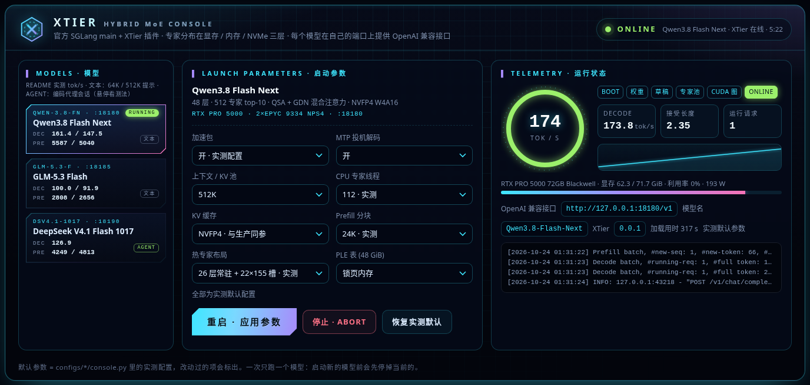

# XTier

[English](docs/README.en.md) · [文档目录](docs/README.md) · [快速开始](docs/quickstart.md) · [支持情况](docs/support.md)

XTier 是官方 [SGLang](https://github.com/sgl-project/sglang) 的插件（跟 main 分支），做 CPU/GPU 分层 MoE 推理：专家分布在显存和内存两层，按热度放置、按需调度；NVMe 只放大嵌入表的行（DeepSeek 的 Engram、Qwen 的 PLE）。内存放不下全部专家时，可选的冷专家池把少用的专家放到硬盘、用到时读回内存，池子大小和速度受限于硬盘速度和类型。

**状态：早期开发**（[工作计划](docs/PLAN.md)）。Qwen3.8 Flash Next、GLM-5.3 Flash、DeepSeek V4.1 Flash 1017 跑在 SGLang main 上；MiniMax-M3.1-Flash 跑在 SGLang 的 M3.1 分支（PR #45925），已暂停开发（本机太慢、智力不强）。

- **不改 SGLang 源码**：只用官方插件框架的钩子（接在官方 KTransformers 混合推理的入口上），加载后自检是否接管成功。
- **与模型无关**：混合推理包在官方 `FusedMoE` 的量化方法外面，用标准 MoE 层的模型装上就能跑（NVFP4、MXFP4 专家）。
- **加速包可选**：某个模型独有的修正和内核放在 `xtier/packs/` 下。

## 结构

```
xtier/
├── backend/   混合 MoE 后端：接管官方量化方法，权重加载完即交给 CPU 引擎；解码走信箱（CUDA 图可捕获），prefill 走 GPU 分组 GEMM 或 CPU
├── cache/     热专家缓存：每层槽数可不同，全部常驻的层不经过 CPU；自适应换入换出；常驻层的 prefill 直接在槽上算；
│              第二张卡当热专家池（可选，`XTIER_GPU2_SLOTS`）
│              冷专家池（可选，`XTIER_COLD=1`）：少用的专家放到硬盘（[设计](docs/design-cold-experts.md)）
├── planner/   规划器：本机探测的 GPU / CPU 耗时 + 路由档案 → 显存预算内每层的热专家槽数（按 CPU 和 GPU 同时算完分配），可在启动时自动算
├── engine/    CPU 引擎的 Python 绑定、绑核、锁页内存（C++ 源码在 csrc/）
├── packs/     加速包：qwen4_exp（PLE 表、PLE 行放 NVMe、hc_mix 重叠内核、QSA 读 NVFP4 KV）、glm5_next（量化排除、DSA、NextN）、
│              deepseek_v4（Engram 行放 NVMe、SM120 候选索引器、FP8 GEMM 调优配置、FP8 wo_a、recipe 分词、分页索引器）、
│              minimax_m3（SM120 通用栈、CUDA 上的 DSpark verify、草稿词表头 FP8、SM120 上读 NVFP4 KV）、
│              speculative（通用投机解码：EAGLE 的热词表配无损拒绝采样、草稿温度、按置信度截断验证；DSpark 按置信度截断验证）
├── tables/    大嵌入表的行放在 NVMe：多段多文件、任意行宽、行缓存、CUDA 图内查表
├── console/   启动台：一个网页选模型、调启动参数、启动 / 停止，跟踪加载阶段与 decode 遥测（只用标准库）
└── platform.py  与模型无关的主机修正（TileLang 目标选择）
csrc/          CPU 引擎：AVX-512 / AVX2 专家内核、NUMA 线程池、CPU 与 GPU 之间的信箱通信
configs/       每个"模型 × 硬件"的启动配置，console.py 是它在启动台里的条目（选项、默认值、启动命令）
tests/         单层测试（引擎、信箱、缓存、prefill、格式适配、hc_mix、投机截断、QSA NVFP4、GPT-OSS SwiGLU、wo_a、MiniMax NVFP4 KV、快速加载、未命中代算）、启动台与规划器检查
tools/         构建、内存看门狗、规划器（plan_probe 探测、plan_trace 路由档案、plan_auto 出方案、plan_calibrate 校准，见 docs/planner.md）
bench/         验收脚本（PPL、照抄、验证步、并发、prefill 延迟）与结果
```

## 快速上手

从空机器到第一次请求的完整路线（环境、模型准备、启动命令、测试请求）见[快速开始](docs/quickstart.md)。已经有 SGLang 环境时：

```bash
git -C /path/to/sglang checkout 27bc1a0615      # 测试过的官方 SGLang main（2026-11-06）
SGLANG_BUILD_RUST_EXTS=none pip install -e /path/to/sglang/python   # 没装 Rust 时跳过 SGLang 可选的 Rust 扩展
tools/build_engine.sh /path/to/site-packages/nvidia/cu13   # CPU 引擎与信箱库 -> xtier/engine/lib
pip install --no-deps -e .                      # 注册插件入口 sglang.srt.plugins: xtier
python tools/check_sglang.py --strict           # 不用模型：核对 SGLang 的提交、XTier 的钩子目标和 import
XTIER=1 XTIER_THREADS=112 XTIER_MAIN_CPUS=auto XTIER_CACHE_SLOTS=155 \
  python -m sglang.launch_server --model-path <MoE 检查点> --cuda-graph-backend-prefill disabled ...
```

XTier 跟着官方 SGLang main 走，每次只认一个测试过的提交（[xtier/__init__.py](xtier/__init__.py) 的 `SGLANG_COMMIT`，更新时写进
版本更新）；装的 SGLang 不是这个提交时，启动日志会警告，`tools/check_sglang.py` 列出挂不上的钩子（加 `--strict` 时提交不同也算失败）。
依赖的版本见 [constraints.txt](constraints.txt)。

开关见 [xtier/config.py](xtier/config.py)；按模型和硬件的完整启动参数见 [configs/](configs/)，也可以用下面的启动台。

快速加载（可选，`XTIER_FAST_LOAD=1`；默认关，即 SGLang 原来的加载方式）：专家直接从模型文件（开冷专家时从冷存储）读进
CPU 引擎，全部读完、检查完才报在线，DeepSeek V4.1 Flash 1017 启动 472 → 186 s（[报告](docs/reports/2026-10-27-fast-load.md)）。
MoE 张量并行（`--tp-size` > 1）时每个 rank 只读自己那份（双 RTX 4090 实测 Qwen3.8 权重加载 170 → 133 s，分片与普通加载逐字节相同）。

## 启动台



在仓库根目录运行 `python3 -m xtier.console`（只用 Python 标准库），打开 http://127.0.0.1:8100/ ：

- **左边模型栏**：每个模型一张小卡片，写着端口和 README 实测速度，标签注明测法（AGENT = agent 速度，文本 = 文本速度），
  模型多了在栏内滚动。
- **中间启动参数**：默认就是实测配置，改过的项会标出。公共的有加速包开关（关 = 测速表里的「基线」）、投机解码、上下文、
  CPU 专家线程，其余是各模型自己的（热专家槽、分块、弹性热专家、冷专家卸载、未命中专家 GPU 代算等）。
- **右边运行状态**：加载阶段（权重 → 草稿 → 专家池 → CUDA 图 → 预热 → 在线），在线后显示 decode 速度、接受长度、显存和日志。

一次只跑一个模型；模型服务在自己的端口上提供 OpenAI 兼容接口，启动台退出不影响它。加模型只要在 `configs/<模型>-<硬件>/` 里
加一个 `console.py`（卡片、选项、启动命令）。细节见 [docs/console.md](docs/console.md)。

## 支持的模型

| 模型 | 官方模块 | 状态 |
|---|---|---|
| Qwen3.8 Flash Next | `qwen4_exp` | 官方 main 上跑通：精度、照抄、512K 召回与生产一致；加速包比基线 冷 prefill 快 5% / 24%（64K / 512K）；KV 存 NVFP4（与生产同参，加速包让官方 QSA 能读），省下的显存用来多放常驻层，启动台默认由规划器自动布局；PLE 表（48 GiB）可放 NVMe，放傲腾时速度与锁页表持平 |
| GLM-5.3 Flash | `glm5_next` | 官方 main 上跑通（含 EAGLE）：加速包（FP8 权重、热词表拒绝采样、截断验证、弹性热专家槽）比基线 长回复每步快 22%，PPL 3.987 → 3.998 |
| DeepSeek V4.1 Flash 1017 | `deepseek_v4` | 官方 main 上跑通（含 DSpark）：Engram 表（189 GB）的行放 NVMe（[设计](docs/design-tables-nvme.md)），照抄 0 错；加速包（含 FP8 wo_a、分页索引器、弹性热专家槽）比基线 长回复每步快 39%、冷 prefill 快 33% |
| MiniMax-M3.1-Flash | `minimax_m3` | **暂停开发**（2026-10-26，本机太慢、智力不强）。SGLang 的 M3.1 分支（PR #45925）上跑通（含 DSpark），加速包比官方代码长回复每步快 34% |

## 支持的显卡

每个模型、显卡和多卡模式实际验证到什么程度（整模型、截层、单层、模拟）见[支持情况](docs/support.md)。

| 显卡 | 状态 |
|---|---|
| Blackwell（SM120） | 开发和测速平台（RTX PRO 5000），下面的测速都在这上面测 |
| RTX 40 系（SM89） | 支持。RTX 4090 实测：Qwen3.8 整模型在单卡 24 GB + 120 GB 内存上照抄 0 错、120K 上下文（[配置](configs/qwen38-rtx4090-3090/README.md)）；GLM-5.3 截层、DeepSeek V4.1 单层测试通过，整模型在本机模拟验证；GLM 要关投机解码。详见[报告](docs/reports/2026-10-29-rtx40.md) |
| RTX 30 系（SM86） | 支持。RTX 3090 实测：Qwen3.8 整模型在单卡 24 GB 上照抄 0 错、120K 上下文，decode 约 42 tok/s（云主机 28 个 CPU 线程）；GLM-5.3 截层、DeepSeek V4.1 单层测试通过，整模型在本机模拟验证。FP8 全部软件解码（与硬件逐位相同），GLM 用 BF16 KV、要关投机解码。详见[报告](docs/reports/2026-10-29-rtx30.md) |

## 多卡（张量并行）

两张卡用张量并行（`TP=2`）：每张卡放每个热专家的一半和一半 KV，每卡能放的热专家槽数是单卡的三倍多；CPU 引擎每个 rank 一个进程，
各用自己 GPU 那组 NUMA 节点（每颗 CPU 带一张卡时正好一卡一 CPU）。两卡之间不需要 P2P / NVLink，SGLang 会自动改走 NCCL。
双 RTX 3090 实测 Qwen3.8：decode 42.1 → 59.6–61.7 tok/s（+42–48%，开 MTP 69–72 tok/s），120K 首字 72.6 → 47.0 s，照抄 0 错。
两张卡显存不一样大时，SGLang 默认拒绝启动，加 `SGLANG_ENABLE_TP_MEMORY_INBALANCE_CHECK=0` 可以跑，但两张卡都只能按小卡的显存放
（24 + 16 GiB 实测每层 64 槽，decode 51 tok/s）。
用法见[配置](configs/qwen38-rtx4090-3090/README.md#two-gpus-tp2)，详见[报告](docs/reports/2026-10-30-tp.md)。

### 异构卡：快卡带慢卡，第二张卡纯当热专家池

两张卡显存或速度不同时，TP 只能按小卡、慢卡的节奏跑。第二张卡可以不放模型，只放热专家（`XTIER_GPU2_SLOTS`，默认关）：

```
XTIER_GPU2_SLOTS=auto CUDA_VISIBLE_DEVICES=快卡,慢卡 bash configs/qwen38-rtx4090-3090/run-qwen.sh
```

- **做法**：主卡没命中、第二张卡有的专家由它算，结果经内存加回 CPU，不需要 P2P；prefill 只用主卡。
- **分配**：`auto` 留 1.5 GiB，其余显存放专家，分工自动调整。
- **精度**：Qwen、GLM、DeepSeek 单层结果和主卡逐位相同。
- **限制**：只支持 `TP=1`，不能和冷专家同用；主卡有硬件 FP4 解码时第二张卡也要有。

测速只比较四种用法：同规格卡 TP、异构卡 TP、同规格卡热池、异构卡热池，单卡作基准。都用 RTX 4090 模拟（Qwen3.8，单请求，输出 512 token），方法见报告。

| 配置 | 每层热专家槽 | 32K decode tok/s | 120K decode tok/s | 120K 首字 |
|---|---|---:|---:|---:|
| 单卡 24 GiB（基准） | 48 | 41.0（100%） | 43.6（100%） | 60.9 s（100%） |
| 同规格卡 TP 24 + 24 GiB | 180（半个专家） | 62.1（151%） | 63.4（145%） | 68.9 s（88%） |
| 异构卡 TP 24 + 16 GiB | 64（半个专家） | 51.1（125%） | 49.4（113%） | 60.0 s（101%） |
| 同规格卡热池 主 24 + 热池 24 GiB | 48 + 178 | 58.2（142%） | 56.2（129%） | 59.3 s（103%） |
| **异构卡热池 主 24 + 热池 16 GiB** | **48 + 113** | **57.3（140%）** | **55.9（128%）** | **58.9 s（103%）** |
| 异构卡热池 主 24 + 热池 16 GiB，热池卡耗时约 1.2 倍 | 48 + 113 | 54.5（133%） | 54.2（124%） | 59.0 s（103%） |

括号是相对单卡的速度，首字按耗时反算。异构卡热池比异构卡 TP 快 12–13%；同规格卡 TP 的 decode 最快。

热池不参与 prefill，首字 103% 不是加速；同规格卡 TP 的 88% 是那次 prefill 卡了约 9 s。

只看趋势：这台 CPU 偏弱，CPU 越强第二张卡省得越少；真实异构卡还没测过，DeepSeek 和 GLM 只测了单层和截层。

照抄：开启时 9 次启动有 3 次翻同一个 token，其余 0 错；单卡反复重算提示词 KV 也会翻。详见[报告](docs/reports/2026-10-31-second-gpu-pool.md)。

## 测速

单卡 RTX PRO 5000 72GB + 2× EPYC 9334（NPS4）+ 384 GiB DDR5，单位 tok/s，只放最新一次的结果。DeepSeek 加速包那两行是 2026-11-11 重测的（v0.1.4，prefill 分块改成 48K），其余各行是 XTier 跟 SGLang main 8cd3c494 时
（2026-10 下旬）测的，后面的版本没有重测，每个版本只回归 64K / 512K 速度和精度（最近一次见[报告](docs/reports/2026-11-01-audit-fixes.md)）。

用 [bench/agent_bench.py](bench/agent_bench.py) 模拟编码代理：5 个会话从 64K 到约 500K，铺满 512K KV 池，多步调用工具，同一次启动
连跑两轮。冷 prefill = 会话第一个请求里未命中缓存的 token / 首字，decode 只算长回复（≥ 300 token）。基线 = 启动台「关加速包」：
官方 SGLang main 加 XTier 的混合推理和跑起来必需的修正，不开提速项，**不是原版 SGLang**。配置、精度和原始数据见[测速细节](docs/benchmarks.md)。

### DeepSeek V4.1 Flash 1017

| DSpark | 轮 | 冷 prefill 64K 会话 | 冷 prefill 500K 会话 | decode（长回复） | 接受长度 | 每步 |
|---|:-:|---:|---:|---:|---:|---:|
| XTier + 加速包 | 1 | 5,268 | 6,576 | 125.5 | 3.85 | 30.7 ms |
|  | 2 | 5,886 | 6,600 | 151.3 | 4.58 | 30.2 ms |
| 基线（关加速包） | 1 | 3,318 | 3,627 | 65.5 | 3.25 | 50.9 ms |

加速包对基线：每步 30.4 对 50.9 ms（快 40%），冷 prefill 64K / 500K 快 68% / 82%；精度无损，照抄正文 0 错（偶尔在一段末尾多输出一个 `</src>`，原来就有）。第 1 轮 decode 的 tok/s 低是那一轮长回复的接受长度短，每步耗时没变。

**冷 prefill 比上一版快 28–35%，decode 不变（2026-11-11）。** 每读一块提示，每层都要把不在热专家槽里的专家传上显卡，约 2.5 秒，和块里有多少 token 无关。启动台默认的 prefill 分块从 22K 加到 48K，这 2.5 秒摊给两倍多的 token。大块的 forward 多用的显存从热专家槽里让（每层 50 → 35 槽），decode 时弹性热专家槽把它还回去（补到 68 槽），所以 decode 每步不变。520K 提示、两个请求占满 512K KV 池都实跑过，没有显存不足。GLM、Qwen 实测分块加大没有收益，没有改。见[报告](docs/reports/2026-11-11-prefill-chunk.md)。

### Qwen3.8 Flash Next

| MTP | 轮 | 冷 prefill 64K 会话 | 冷 prefill 500K 会话 | decode（长回复） | 接受长度 | 每步 |
|---|:-:|---:|---:|---:|---:|---:|
| XTier + 加速包 | 1 | 5,715 | 5,170 | 181.7 | 2.57 | 14.2 ms |
|  | 2 | 5,610 | 5,150 | 207.2 | 2.68 | 13.0 ms |
| 基线（关加速包） | 1 | 5,319 | 4,078 | 139.5 | 2.13 | 15.2 ms |

加速包（规划器自动布局）对基线：每步 13.6 对 15.2 ms（快 11%），冷 prefill 64K / 500K 快 6% / 27%；精度轻微损失
（KV 存 NVFP4，与生产相同），PPL 3.481，照抄 0 错。

### GLM-5.3 Flash

| EAGLE | 轮 | 冷 prefill 64K 会话 | 冷 prefill 500K 会话 | decode（长回复） | 接受长度 | 每步 |
|---|:-:|---:|---:|---:|---:|---:|
| XTier + 加速包 | 1 | 2,648 | 2,640 | 96.3 | 2.54 | 26.4 ms |
|  | 2 | 2,715 | 2,635 | 98.2 | 2.66 | 27.1 ms |
| 基线（关加速包） | 1 | 2,663 | 2,518 | 76.8 | 2.61 | 34.4 ms |

加速包（58 槽 + 弹性热专家槽）对基线：每步 26.9 对 34.4 ms（快 22%），冷 prefill 64K / 500K 快 1% / 5%；精度轻微损失
（注意力 / 稠密层存 FP8，PPL 3.987 → 3.998），照抄 0 错。

### MiniMax-M3.1-Flash（暂停开发）

| DSpark | 轮 | 冷 prefill 64K 会话 | decode（长回复） | 接受长度 | 每步 |
|---|:-:|---:|---:|---:|---:|
| XTier + 加速包 | 1 | 1,854 | 53.4 | 3.04 | 56.9 ms |
|  | 2 | 1,877 | 50.0 | 2.70 | 54.0 ms |
| 官方代码 + 必要修正 | 1 | 1,824 | 46.8 | 3.94 | 84.3 ms |
|  | 2 | 1,883 | 45.5 | 3.82 | 84.0 ms |

SGLang 的 M3.1 分支（PR #45925），固定 512K，只跑 64K 会话；加速包对官方代码 + 必要修正每步 55.4 对 84.1 ms（快 34%）。

## 冷专家卸载到硬盘

内存放不下全部专家时，每层只把一部分专家放内存，其余放 NVMe 上的冷专家池，路由到时读回内存再算（`XTIER_COLD=1`，默认关，
[设计](docs/design-cold-experts.md)）。一次缺失所有盘同时读，速度主要看盘。启动台的 DeepSeek 卡片可选卸载 10% / 20% / 30%。

四个模型都按卸载 30% 跑过端到端回归（照抄 0 错、dsh 15 分钟 0 失败，当时是 4 块 PCIe 4.0 盘）：

| 模型 | 每层在内存的专家 | 所需内存（不卸载 → 卸载 30%） |
|---|---|---:|
| DeepSeek V4.1 Flash 1017 | 269 / 384 | 298 → 224 GiB |
| GLM-5.3 Flash | 202 / 288 | 174 → 129 GiB |
| Qwen3.8 Flash Next | 358 / 512（只卸载 CPU 上的 18 层） | 121 → 116 GiB |
| MiniMax-M3.1-Flash | 90 / 128 | 227 → 165 GiB |

### DeepSeek V4.1 Flash 1017：卸载比例与速度

4 块 PCIe 5.0 盘（三星 9100 PRO，四盘同读 50.6 GB/s），agent_bench 的 64K 会话，单次运行（±5–10%）：

| 卸载 | 放到硬盘 | decode 每步 / tok/s | 64K 冷 prefill（tok/s） |
|---|---:|---|---|
| 不卸载 | 0 | 30.0 ms / 142 | 4,300 |
| 10% | 27 GiB | 31.6 ms / 135（−5%） | 3,784（−12%） |
| 20% | 54 GiB | 34.4 ms / 124（−13%） | 3,742（−13%） |
| 30% | 81 GiB | 37.9 ms / 112（−21%） | 3,731（−13%） |
| 40% | 108 GiB | 44.5 ms / 96（−32%） | 3,672（−15%） |
| 50% | 134 GiB | 53.5 ms / 80（−44%） | 3,537（−18%） |

盘要先测几分钟的持续读：无 DRAM 的盘（如 HP FX700）满速读约 100 秒后会掉到约 60 MB/s，拖住整个池子。明细见[报告](docs/reports/2026-11-01-cold-pcie5.md)。

### 大模型只存一份

冷存储本来就存全部专家，`tools/cold_punch.py` 逐字节核对后，把模型文件里的这部分打洞释放（`--restore` 可写回）：DeepSeek V4.1 Flash 1017
290 → 21 GiB。代价：冷存储成了唯一一份，盘坏了要重新下载模型；没有 XTier 的 SGLang 不能再加载这个目录。

### 可选项（默认关）

- **盘数不是 4 块或盘速不一样**：`XTIER_COLD_UNITS=3` 按盘速分配（如 `XTIER_COLD_PARTS=5:5:5:5:2:2`），已有的存储用
  `tools/cold_relayout.py` 换布局。[报告](docs/reports/2026-11-06-cold-units-tail-skip.md)
- **尾部跳过**（会改变输出）：`XTIER_TAIL_SKIP=5/6`（保留/总共），decode 时 CPU 算的专家没被任何 token 排进前 5 名就跳过。DeepSeek
  不卸载时每步只快 2.3%，专家大多在盘上时收益大。[报告](docs/reports/2026-11-06-tail-skip-cpu.md)

### 最小化运行：32 GB 显存 + 128 GB 内存跑 DeepSeek V4.1 Flash 1017

模拟一张 RTX 5090：32 GB 显存、128 GB 内存都是硬上限，冷专家 70%，冷存储是 4 块 PCIe 4.0 盘（启动台卡片「DeepSeek V4.1 Flash 1017 ·
最小化」）。速度约为正常配置的 25%，瓶颈在读盘，详见[报告](docs/reports/2026-10-27-ds41-minimal.md)。

| 单位 tok/s | 32K | 64K | 128K |
|---|---:|---:|---:|
| prefill（32 GB + 128 GB） | 1,186 | 1,165 | 1,155 |
| decode（32 GB + 128 GB） | 28.5 | 28.1 | 32.7 |
| prefill（正常配置） | 3,886 | 4,609 | 4,655 |
| decode（正常配置） | 130.7 | 127.9 | 122.4 |

## 版本更新

- 2026-11-11：DeepSeek V4.1 的冷 prefill 快 28–35%，decode 不变。启动台默认的 prefill 分块从 22K 改成 48K：每读一块都要花约 2.5 秒把专家传上显卡，块大了这段时间摊给更多 token。每层热专家基础槽 50 → 35，decode 时弹性热专家槽补回到 68；「Prefill 中穿插 decode」默认 48 → 72 步，另一个请求仍保持约 20% 的速度（最长停顿 4.7 → 7.4 秒）。520K 提示和两个请求占满 512K KV 池实跑没有显存不足。GLM、Qwen 实测分块加大没有收益，不改。[报告](docs/reports/2026-11-11-prefill-chunk.md)
- 2026-11-10（v0.1.4）：一个请求读长提示时，另一个正在 decode 的请求不再整段停住。SGLang 调度时 prefill 优先，旁边有 20 万 token 的冷提示在读时另一个请求要停 40 秒左右。启动台现在默认加 SGLang 自带的 `--prefill-decode-interval`（DeepSeek 48 / GLM 64 / Qwen 96 步，可改可关）：另一个请求保留约两成速度，最长等一块 prefill 的时间（约 5 秒），长提示首字晚 26–28%，单个请求不变。修复：弹性热专家槽在一个提示的分块之间不再加回又释放（DeepSeek 每块白传 8.4 GiB）。详见[报告](docs/reports/2026-11-10-prefill-interleave.md)。
- 2026-11-10（v0.1.3）：稳定性审阅后的修复，正常路径不变。别的程序抢 CPU 时解码会慢十倍：启动台给服务高 CPU 权重，登录会话里的程序用 `tools/low_cpu.sh` 起；SGLang 的指标文件挪到内存盘，系统盘卡住不再拖停解码；装钩子出错直接退出，不再带着半套 XTier 起；DeepSeek 的 FP4 prefill 失败后重跑不再段错误；冷存储是唯一副本时不会被别的目录用零重写；崩溃时不再把几百 GiB 内存写进核心转储。详见[报告](docs/reports/2026-11-10-stability-fixes.md)。
- 2026-11-06（v0.1.2）：跟进官方 SGLang main 27bc1a0（依赖有变化）。修复：SGLang 把 DeepSeek 索引器的 DeepGEMM 路径收窄到 SM100 系列，SM120 显卡（如 RTX PRO 5000）上 520K prefill 慢了 1.8 倍，XTier 加了一个钩子让 SM120 继续走 DeepGEMM，速度恢复；Engram 补上 SGLang 新加的 MXFP4 属性；变长验证改用 SGLang 自己的映射。三个模型回归通过，详见[报告](docs/reports/2026-11-06-sglang-27bc1a0.md)。
- 2026-11-06（晚）：DeepSeek V4.1 的变长验证（`SGLANG_RAGGED_VERIFY_MODE=compact`）能跑对了（感谢 [cyrus-xc](https://github.com/cyrus-xc)，[#13](https://github.com/a775828b-dot/xtier/pull/13)）。要配本机实测的成本表才生效（`tools/sps_profile.py`）：我们的测试机上单请求不变，两个请求同时快 17%，照抄 0 错。默认仍是 static，启动台的 DS 卡可选「变长」；其他机器请先测表。详见[报告](docs/reports/2026-11-06-ds-compact-verify.md)。
更早的版本更新见 [docs/changelog.md](docs/changelog.md)。

## 许可

Apache-2.0，见 [LICENSE](LICENSE) 与 [NOTICE](NOTICE)。
