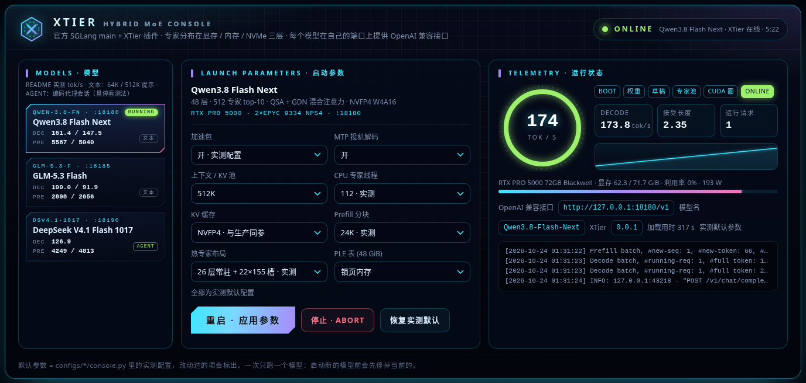

# XTier

**Cross-tier CPU/GPU hybrid MoE inference for [SGLang](https://github.com/sgl-project/sglang).**
XTier is a plugin for upstream SGLang (tracking `main`): MoE experts live across GPU memory, host DRAM and NVMe, are placed by
how often they are used and computed where they are. It wraps SGLang's standard `FusedMoE` quantization methods, so any MoE model
that uses the standard layer can run in hybrid mode without model-specific code; optional per-model acceleration packs add
model-specific optimizations. **Status: early development** — Qwen3.8 Flash Next, GLM-5.3 Flash and DeepSeek V4.1 Flash 1017
run on SGLang main, MiniMax-M3.1-Flash on SGLang's M3.1 branch (PR #45925); see [docs/PLAN.md](docs/PLAN.md).

---

XTier 是官方 SGLang 的插件（跟 main 分支），做 CPU/GPU 分层 MoE 推理：专家分布在显存、内存和 NVMe 三层，按热度放置、按需调度。

- **不改 SGLang 源码**：只用官方插件框架的钩子（接在官方 KTransformers 混合推理的入口上），加载后自检是否接管成功。
- **与模型无关**：混合推理包在官方 `FusedMoE` 的量化方法外面，用标准 MoE 层的模型装上就能跑（NVFP4、MXFP4 专家）。
- **加速包可选**：某个模型独有的修正和内核放在 `xtier/packs/` 下。

## 结构

```
xtier/
├── backend/   混合 MoE 后端：接管官方量化方法，权重加载完即交给 CPU 引擎；解码走信箱（CUDA 图可捕获），prefill 走 GPU 分组 GEMM 或 CPU
├── cache/     热专家缓存：每层槽数可不同，全部常驻的层不经过 CPU；自适应换入换出；常驻层的 prefill 直接在槽上算
├── planner/   规划器：决定每层由谁算、缓存多少（目前按配置，目标是 CPU 和 GPU 同时算完）
├── engine/    CPU 引擎的 Python 绑定、绑核、锁页内存（C++ 源码在 csrc/）
├── packs/     加速包：qwen4_exp（PLE 表、PLE 行放 NVMe、hc_mix 重叠内核、QSA 读 NVFP4 KV）、glm5_next（量化排除、DSA、NextN）、
│              deepseek_v4（Engram 行放 NVMe、SM120 候选索引器、FP8 GEMM 调优配置、FP8 wo_a、recipe 分词、分页索引器）、
│              minimax_m3（SM120 通用栈、CUDA 上的 DSpark verify、草稿词表头 FP8）、
│              speculative（通用 EAGLE 投机解码：热词表配无损拒绝采样、草稿温度、按置信度截断验证）
├── tables/    大嵌入表的行放在 NVMe：多段多文件、任意行宽、行缓存、CUDA 图内查表
├── console/   启动台：一个网页选模型、调启动参数、启动 / 停止，跟踪加载阶段与 decode 遥测（只用标准库）
└── platform.py  与模型无关的主机修正（TileLang 目标选择）
csrc/          CPU 引擎：AVX-512 / AVX2 专家内核、NUMA 线程池、CPU 与 GPU 之间的信箱通信
configs/       每个"模型 × 硬件"的启动配置，console.py 是它在启动台里的条目（选项、默认值、启动命令）
tests/         单层测试（引擎、信箱、缓存、prefill、格式适配、hc_mix、投机截断、QSA NVFP4、GPT-OSS SwiGLU、wo_a）与启动台检查
bench/         验收脚本（PPL、照抄、验证步、并发、prefill 延迟）与结果
```

## 快速上手

```bash
pip install -e /path/to/sglang/python          # 官方 SGLang main
tools/build_engine.sh /path/to/site-packages/nvidia/cu13   # CPU 引擎与信箱库 -> xtier/engine/lib
pip install --no-deps -e .                      # 注册插件入口 sglang.srt.plugins: xtier
XTIER=1 XTIER_THREADS=112 XTIER_MAIN_CPUS=auto XTIER_CACHE_SLOTS=155 \
  python -m sglang.launch_server --model-path <MoE 检查点> --cuda-graph-backend-prefill disabled ...
```

开关见 [xtier/config.py](xtier/config.py)；按模型和硬件的完整启动参数见 [configs/](configs/)，也可以用下面的启动台。

## 启动台



在仓库根目录运行 `python3 -m xtier.console`（只用 Python 标准库），打开 http://127.0.0.1:8100/ ：

- **左边模型栏**：每个模型一张小卡片，写着端口和 README 实测速度，标签注明测法（AGENT = agent 速度，文本 = 文本速度），
  模型多了在栏内滚动。
- **中间启动参数**：默认就是实测配置，改过的项会标出。公共的有加速包开关（关 = 测速表里「官方 main」的配置）、投机解码、上下文、
  CPU 专家线程；各模型自己的有 Qwen 的 KV 精度、分块、常驻层布局、PLE 表放内存还是 NVMe，GLM 的拒绝采样、热专家槽、分块，
  DeepSeek 的 Engram 行缓存、热专家槽、分块，MiniMax 的热专家槽、DSpark 草稿长度、分块。
- **右边运行状态**：加载阶段（权重 → 草稿 → 专家池 → CUDA 图 → 预热 → 在线），在线后显示 decode 速度、接受长度、显存和日志。

一次只跑一个模型；模型服务在自己的端口上提供 OpenAI 兼容接口，启动台退出不影响它。加模型只要在 `configs/<模型>-<硬件>/` 里
加一个 `console.py`（卡片、选项、启动命令）。细节见 [docs/console.md](docs/console.md)。

## 支持的模型

| 模型 | 官方模块 | 状态 |
|---|---|---|
| Qwen3.8 Flash Next | `qwen4_exp` | 官方 main 上跑通：精度、照抄、512K 召回与生产一致；按 agent_bench，加速包后 decode 每步与生产持平（14.1 对 13.9 ms），冷 prefill 500K 快 7%、64K 慢 15%；KV 存 NVFP4（与生产同参，加速包让官方 QSA 能读），省下的显存多放一层常驻；PLE 表（48 GiB）可放 NVMe，放傲腾时速度与锁页表持平 |
| GLM-5.3 Flash | `glm5_next` | 官方 main 上跑通（含 EAGLE）：按 agent_bench，加速包后 decode 每步比生产快 11%（27.5 对 30.9 ms，热词表拒绝采样与生产相同），冷 prefill 持平或略快，PPL 3.994（生产 4.060） |
| DeepSeek V4.1 Flash 1017 | `deepseek_v4` | 官方 main 上跑通（含 DSpark）：Engram 表（189 GB）的行放 NVMe（[设计](docs/design-tables-nvme.md)），照抄 0 错；按生产的 agent_bench（同一套编码代理会话）实测：冷 prefill 500K 比生产快 24%，decode 每步慢约 2%（32.5 对 32.0 ms：wo_a 换成检查点的 FP8、索引器走分页路径之后） |
| MiniMax-M3.1-Flash | `minimax_m3` | SGLang 的 M3.1 分支（PR #45925，还没合入 main）上跑通（含 DSpark）：SM120 上四处必需的修正（PR 把 SM120 当 SM100：原生栈、FP8 KV + TRT-LLM、MegaMoE、CUDA 上的 DSpark verify），CPU 引擎和 GPU 内核加了 GPT-OSS SwiGLU；按 agent_bench（64k 会话），加速包后 decode 每步快 16%（59.5 对 70.6 ms），tok/s 快 3%（草稿短了、接受长度也短），照抄 0 错；没有生产管线可比 |

## 测速

单卡 RTX PRO 5000 72GB + 2× EPYC 9334（NPS4）+ 384 GiB DDR5，官方 SGLang main 8cd3c494（MiniMax 用 SGLang 的 M3.1 分支），单位 tok/s，表里只放最新一次的结果。

**agent 速度**：生产仓库的 agent_bench（[bench/agent_bench.py](bench/agent_bench.py)：lsglang_ds4.1 那份加两处健壮性修正，计时不变），
模拟编码代理（dsh / Claude Code 一类工具）：5 个会话从 64K 到约 500K，铺满 512K KV 池，多步调用工具，后续请求命中前缀缓存，
服务端默认采样，同一次启动连跑两轮，XTier 与生产两边都测。冷 prefill = 会话第一个请求里未命中缓存的 token / 首字；decode 只算
长回复（≥ 300 token，写代码、写总结），接受长度随内容变，比较两边先看每个验证步的耗时。表用 [bench/agent_table.py](bench/agent_table.py)
生成，每会话明细见[报告](docs/reports/2026-10-24-ds-woa-minimax.md)。

### DeepSeek V4.1 Flash 1017

| DSpark | 轮 | 冷 prefill 64K 会话 | 冷 prefill 500K 会话 | decode（长回复） | 接受长度 | 每步 |
|---|:-:|---:|---:|---:|---:|---:|
| XTier + 加速包 | 1 | 3,196 | 4,788 | 112.7 | 3.76 | 33.4 ms |
|  | 2 | 5,022 | 4,793 | 137.6 | 4.46 | 32.4 ms |
| 生产（lsglang_ds4.1，10-22） | 1 | 3,377 | 3,856 | 142.7 | 4.56 | 31.9 ms |
|  | 2 | 4,431 | 3,856 | 136.1 | 4.36 | 32.0 ms |

- 每步 XTier 慢约 2%（两轮长回复合计 32.5 对 32.0 ms；10-24 换上 FP8 wo_a 之前 6%、索引器走分页路径之前 3%），接受长度随内容变
  （第 1 轮可计时的长回复只有 3 个）；冷 prefill 500K XTier 快 24%，64K 第 2 轮快 13%（两边第 1 轮的 64K 会话都偏慢）。
- 官方 main 的 DeepSeek 工具调用解析不逐 token 流式返回参数，XTier 上工具调用请求量不出 decode（两轮 177 个请求里能计时 13 个）；
  生产所有请求都能计时，算上工具调用（输出短、接受长度高）是 158.6 / 144.6 tok/s。
- 加速包精度：无损——块 FP8 GEMM 的分块配置和内核、Engram 提前查表（取到的行不变）、草稿词表头 FP8（只影响草稿提案，输出仍由主模型
  验证）、wo_a 存检查点的 FP8（还原逐位一致，kernel 与 cuBLAS 只差求和顺序）、索引器走分页路径（logits 与非分页路径逐位相同，top-k
  只在同分时可能选到不同位置），PPL 3.319 → 3.317（分页索引器之前测），照抄 0 错。
- 原始数据 `bench/results/agent-bench-ds41-xtier-paged-r{1,2}-20261024.json`（分页索引器之前的两轮：`agent-bench-ds41-xtier-woa-*`）。

### Qwen3.8 Flash Next

| MTP | 轮 | 冷 prefill 64K 会话 | 冷 prefill 500K 会话 | decode（长回复） | 接受长度 | 每步 |
|---|:-:|---:|---:|---:|---:|---:|
| XTier + 加速包 | 1 | 5,374 | 5,053 | 180.1 | 2.55 | 14.1 ms |
|  | 2 | 5,479 | 5,050 | 183.5 | 2.60 | 14.1 ms |
| 生产（lsglang_q3.8fn） | 1 | 6,441 | 4,705 | 171.3 | 2.52 | 14.7 ms |
|  | 2 | 6,271 | 4,689 | 205.5 | 2.62 | 12.7 ms |

- 每步按会话看两边相同（64K 14.3、256K 14.8、384K 15.3、500K 15.4 ms），只有写长文件的 128k-write 会话生产快（10.4–11.7 对
  12.9–13.1 ms），两轮长回复合计 XTier 14.1、生产 13.9 ms。冷 prefill 500K XTier 快 7%，64K 生产快 15–18%（文本测法下 64K 是 XTier
  快 3%，这次的差距在查）。工具调用逐 token 流式，所有请求都能计时。
- 加速包精度：轻微——KV 存 NVFP4（与生产相同，每 16 个值一个 E4M3 缩放；读出与官方反量化逐位一致），照抄 0 错、PPL 3.481；hc_mix
  换成重叠的持久内核、PLE 层与 QSA 索引器分段与官方逐位一致。
- 原始数据 `bench/results/agent-bench-qwen38-{xtier,prod}-r{1,2}-20261024.json`。

### GLM-5.3 Flash

| EAGLE | 轮 | 冷 prefill 64K 会话 | 冷 prefill 500K 会话 | decode（长回复） | 接受长度 | 每步 |
|---|:-:|---:|---:|---:|---:|---:|
| XTier + 加速包 | 1 | 1,747 | 2,509 | 94.4 | 2.53 | 26.8 ms |
|  | 2 | 2,726 | 2,659 | 95.5 | 2.68 | 28.1 ms |
| 生产（lsglang_glm5.3） | 1 | 2,368 | 2,552 | 80.8 | 2.46 | 30.5 ms |
|  | 2 | 2,597 | 2,551 | 84.1 | 2.62 | 31.2 ms |

- 每步 XTier 快 11%（两轮长回复 27.5 对 30.9 ms，decode 95.0 对 82.7 tok/s；算上工具调用 97.3 对 84.8 tok/s）。冷 prefill 第 2 轮
  64K 快 5%、500K 快 4%（XTier 第 1 轮 64K 会话是启动后的第一个请求，1,747）。
- 加速包精度：轻微——BF16 注意力 / 稠密层存成 FP8（每行每 128 列一个 scale），PPL 3.987 → 3.998（+0.3%）；拒绝采样与截断验证无损
  （输出分布与不用投机解码相同），照抄 0 错。
- 原始数据 `bench/results/agent-bench-glm53-{xtier,prod}-r{1,2}-20261024.json`。

### MiniMax-M3.1-Flash

SGLang 的 M3.1 分支（PR #45925，还没合入 main）+ XTier，128K KV 池（FP8）：agent_bench 的 128k-write 会话预填的历史就有 13.3 万
token，放不下，只跑 64k 会话；MiniMax 常在第一步就把 4096 个输出 token 全用来思考（没到工具调用就到了上限），所以每轮是一个
64K 冷 prefill 加一到两个长回复，同一次启动连跑四轮，表里是中位数（括号里是范围）。没有生产管线可比，对比的是官方代码加必要修正。

| DSpark | 轮 | 冷 prefill 64K 会话 | decode（长回复） | 接受长度 | 每步 |
|---|:-:|---:|---:|---:|---:|
| XTier + 加速包 + MXFP8 prefill 修正 | 1–2 | 1,963 | 55.8 | 3.26 | 58.4 ms |
| XTier + 加速包 | 1–4 | 1,606 | 54.3（52.5–55.7） | 3.23 | 59.5 ms |
| 官方代码 + 必要修正 | 1–4 | 1,607 | 52.7（51.8–55.1） | 3.72 | 70.6 ms |

- **官方代码 + 必要修正**（启动台「关加速包」）：PR 的代码加上在 SM120 上跑起来必需的修正（`xtier/packs/minimax_m3`：SM120 走 SGLang
  给 Hopper 的通用栈、CUDA 上的 DSpark verify），检查点的草稿长度 7，热专家每层 16 槽。**+ 加速包**：草稿长度 5、热专家换入节奏
  照 DeepSeek（每 2 窗、每次最多 32 个）、草稿词表头 FP8、6 行验证的 MXFP8 投影走 b12x。
- 第一行是 10-24 上午加了平台修正（SM120 的 MXFP8 GEMM 在 prefill 大小上用 128×128 tile，见配置）之后的两轮：冷 prefill 快 22%，
  decode 不受影响（与第二行的差别在轮次波动内）。官方代码那行同样受益（这个修正不属于加速包），没有复测。
- 加速包每步快 16%（59.5 对 70.6 ms），接受长度短 13%（草稿 5 对 7），tok/s 快 3%；冷 prefill 相同。加速包的其他项配检查点的
  草稿 7 是每步 68.5 ms、53.2 tok/s（四轮中位数），所以默认用 5。
- 8 槽 + 256K 池（启动台另一档，128k-write 会话放得下）：一轮，冷 prefill 64K 1,606、128K 1,588 tok/s，长回复 47.6 tok/s、每步
  68.1 ms（槽少一半，热专家命中 0.24）。
- decode 受 CPU 专家限制：每步约 60% 在等 CPU（未命中的专家每个约 32 MB，读一个约 67 µs，约 470 GB/s）；草稿短一点每层少读专家，
  接受长度也短一点，更多见[报告](docs/reports/2026-10-24-ds-woa-minimax.md)。
- 精度：照抄 0 错（单 / 双并发各 8 段，温度 0）；CPU 引擎的 GPT-OSS SwiGLU 与 FP32 参考相对误差 1e-6，GPU 部分（W4A16）与 CPU 引擎
  1.3e-3（`tests/swiglu_oai_check.py`、`hybrid_prefill_check.py`、`cache_check.py`）。草稿长度、换入节奏、草稿词表头 FP8 都不改
  主模型的输出。
- 原始数据 `bench/results/agent-bench-minimax31-{xtier,base,xtier-gamma7}-r{1,2,3,4}-20261024.json`、
  `agent-bench-minimax31-xtier-tile-r{1,2}-20261024.json`、`agent-bench-minimax31-xtier-256k-r1-20261024.json`。

### 配置

- **官方 main**（启动台「关加速包」）：XTier 后端加上跑起来必需的修正，不开任何提速项。必需的修正：Qwen 的 PLE 表锁页分配；GLM 的量化排除、DSA
  别名、NextN 草稿量化；DeepSeek 的 SM120 候选索引器、Engram 行放 NVMe、尾部重放不走 CUDA 图；
  MiniMax 的 SM120 通用栈和 CUDA 上的 DSpark verify（`xtier/packs/minimax_m3`）。
- **热专家布局与启动参数与生产相同**：Qwen NVFP4 KV、其余层每层 155 槽；GLM 每层 60 槽、16K 分块、BF16 SSM 状态、拒绝采样；
  DeepSeek 每层 50 槽；MiniMax（没有生产管线）每层 16 槽、128K FP8 KV 池、16K 分块。
  不同的地方：Qwen 加速包那行 26 层常驻（比生产多第 27 层，用 NVFP4 KV 省下的显存，prefill +0.5–1.4%）、
  24K 分块（生产 32K：这里 32K 在 64K 冷 prefill 慢 3%），见[报告](docs/reports/2026-10-24-qwen-kv-ds-agent.md)；Qwen 官方 main
  用 FP8 KV（官方 main 的 QSA 读不了 NVFP4）、16K 分块、生产的 25 层常驻；GLM 的官方 main 用 BF16 权重，60 槽时 prefill 显存不够，
  减到 55 槽，也不开拒绝采样（官方 main 不允许热词表配拒绝采样）。文本测法（64K / 512K 提示）下的官方 main 对加速包见
  [reports/2026-10-23-speculative-fp4kv.md](docs/reports/2026-10-23-speculative-fp4kv.md)。
- **+ 加速包**：Qwen 是 hc_mix 重叠内核（`XTIER_HC_MIX_OVERLAP`）、PLE 层分段（`XTIER_PLE_BLOCK`）、QSA 索引器 prefill 按键分段
  （`XTIER_QSA_KEYS_PER_CTA`）和 QSA 读 NVFP4 KV（`XTIER_QSA_FP4`）；GLM 是 FP8 权重（`XTIER_FP8_WEIGHTS`，生产用的也是这一套）和通用投机解码包（热词表拒绝采样、
  草稿温度 ×0.8、按草稿置信度截断验证，截掉的 token 跳过 CPU 专家，`xtier/packs/speculative/`）；
  DeepSeek 是调好的块 FP8 GEMM 配置、MXFP8 走 FlashInfer CUTLASS（解码宽度走 b12x）、Engram 提前查表（`XTIER_ENGRAM_PREFETCH`）、
  草稿词表头 FP8（`XTIER_DRAFT_LMHEAD_FP8`）和 wo_a 存检查点的 FP8、decode 走 Triton 分组 einsum（`XTIER_DS_WO_A`）、索引器 decode 走官方的分页路径（`XTIER_DS_PAGED_INDEXER`）；
  MiniMax 是 DSpark 草稿长度 5（`GAMMA`，检查点 7）、热专家换入节奏照 DeepSeek（`XTIER_CACHE_EVERY=2`、`XTIER_CACHE_SWAPS=32`）、
  草稿词表头 FP8（与 DeepSeek 同一个钩子）、6 行验证的 MXFP8 投影走 b12x（`XTIER_MXFP8_B12X_ROWS`，DeepSeek 包的钩子）。
- **平台修正**（`xtier/platform.py`，与模型无关，开不开加速包都在）：SGLang 只按 decode 的形状给 FlashInfer 的 GEMM 做自动调优，
  prefill 大小的 MXFP8 GEMM 查不到缓存，退回 SM120 上最小的 128×32 tile；256 行起改用 128×128（输出逐位相同，16384 行时快 1.5–5.7 倍）：
  MiniMax 64K 冷 prefill +22%；DeepSeek 的 MXFP8 调用被 SGLang 固定了 tactic（`pin_tactic`），不受影响。
- **接口参数与生产相同**：推理解析、工具调用解析（DeepSeek `deepseekv41`、GLM `glm47`、Qwen `qwen3_coder`、MiniMax `minimax-m3`）和缓存命中上报
  （`--enable-cache-report`：usage 里的 `prompt_tokens_details.cached_tokens`，dsh 一类客户端据此显示缓存命中）。

## 版本更新

- 2026-10-24（上午，二）：平台修正：SM120 上 MXFP8 GEMM 在 prefill 大小（≥ 256 行）用 128×128 tile（SGLang 只按 decode 的形状
  调优，prefill 退回 128×32；输出逐位相同）：MiniMax 64K 冷 prefill 1,606 → 1,963 tok/s，decode 不变，照抄 0 错。详见
  [reports/2026-10-24-ds-woa-minimax.md](docs/reports/2026-10-24-ds-woa-minimax.md)。
- 2026-10-24（上午）：新模型 MiniMax-M3.1-Flash（SGLang 的 M3.1 分支 PR #45925，单独的 venv）：`xtier/packs/minimax_m3` 修了 PR 在
  SM120 上的四处问题（参数解析选了 SM100 的原生栈、原生栈判定、专家 scheme、CUDA 上没有 DSpark verify），CPU 引擎和 GPU 内核加
  GPT-OSS SwiGLU；加速包：草稿长度 5、热专家换入照 DeepSeek 的节奏、草稿词表头 FP8，agent 长回复每步 70.6 → 59.5 ms，照抄 0 错；
  启动台加 MiniMax 卡片，经 WebUI → 8000 用本机 dsh 跑真实编码任务 2.9 分钟做完、7 个测试全过。DeepSeek 的索引器 decode 在 SM120 上
  走官方给 SM90 的分页路径（索引器内核每步 1.08 → 0.33 ms），agent 长回复每步 33.0 → 32.5 ms（生产 32.0），照抄 0 错。详见 [reports/2026-10-24-ds-woa-minimax.md](docs/reports/2026-10-24-ds-woa-minimax.md)。
- 2026-10-24（清晨）：DeepSeek 加速包把注意力的 wo_a 存成检查点的 FP8、decode 走 Triton 分组 einsum（官方 main 把 32 × 32 块的 wo_a
  反量化成 BF16，cuBLAS 在 SM120 上用 SM80 的 WMMA 内核）：agent 长回复每步 33.9 → 33.0 ms（生产 32.0），照抄 0 错，显存 −1.25 GiB；
  DeepSeek 的提示按 deepseek-recipe 分词（消息内容里的控制 token 拼写不再变成控制 token，568K 的对话分词 1.3 → 0.18 s）。Qwen、GLM 改列
  agent 速度（XTier 与生产各两轮），README 不再放文本速度。修了 TP 1 时带语法约束的请求让 NCCL 现申请 512 MB 显存（GLM 的第一个工具
  请求在 64K prefill 之后 OOM）。仓库加 agent_bench 副本（生产那份加非法 JSON 工具参数的处理）。本机 dsh 经 8000 对三个模型各跑了一个
  真实编码任务，都做完并自测通过。详见 [reports/2026-10-24-ds-woa-minimax.md](docs/reports/2026-10-24-ds-woa-minimax.md)。
- 2026-10-24（夜）：README 加启动台介绍；测速分成 agent 速度和文本速度，以后统一用 agent 速度：DeepSeek 改列 agent 速度（与生产
  同一套 agent_bench，每会话明细见 [reports/2026-10-24-qwen-kv-ds-agent.md](docs/reports/2026-10-24-qwen-kv-ds-agent.md)），Qwen、GLM
  暂为文本速度。启动参数补上生产的接口参数：三个模型 `--enable-cache-report`，GLM、Qwen 的工具调用解析器（`glm47`、`qwen3_coder`）；
  按 dsh 的请求（流式 chat completions）实测三个模型：缓存命中正常上报，工具调用正常解析。
- 2026-10-24：控制台 `xtier/console/`（`python3 -m xtier.console`）：一个网页管所有模型——选模型、调启动参数（默认是实测配置）、
  启动 / 停止，跟踪加载阶段与 decode 遥测；每个模型在 `configs/*/console.py` 里描述，加模型只要加一个配置目录。
  见 [docs/console.md](docs/console.md)。
- 2026-10-24：Qwen 默认改为 NVFP4 KV（与生产同参），省下的 1.8 GB 显存实测三种用法：多放一层常驻（冷 prefill 64K +1.4%、
  512K +0.5%）、加热专家槽（无效）、32K 分块（64K 慢 3%），decode 都不变（受 GPU 限制），采用第一种；DeepSeek 按生产的 agent_bench 实测：冷 prefill 快 10–25%，decode 每步慢约 6%（CPU 专家侧不慢，差在 GPU 侧）。
  详见 [reports/2026-10-24-qwen-kv-ds-agent.md](docs/reports/2026-10-24-qwen-kv-ds-agent.md)。
- 2026-10-23（夜）：通用投机解码包 `xtier/packs/speculative/`：GLM 用上生产的热词表无损拒绝采样、草稿温度 ×0.8 和按草稿置信度
  截断验证（截掉的验证 token 跳过 CPU 专家，核心加了逐 token 标志），生产的温度 1.0 测法 93.0 → 95.6 tok/s（生产 84.8），README 测法
  64K / 512K decode 94.7 → 100.0、86.7 → 91.9 tok/s，照抄 0 错；三个加速包按当前代码重测；
  Qwen 的 QSA 能读 NVFP4 KV（与官方反量化逐位一致，显存多 1.7 GB），测速表仍用 FP8；DeepSeek 剩余差距排查：热专家命中率、CPU
  每层耗时与生产持平，差别来自测法不同。详见 [reports/2026-10-23-speculative-fp4kv.md](docs/reports/2026-10-23-speculative-fp4kv.md)。
- 2026-10-23（晚）：512K prefill 追平生产。Qwen：QSA 索引器 prefill 的 logits 内核在长上下文时只开 11 个 CTA，加速包按键分段（逐位一致），
  PLE 层分段、分块 16K → 24K，512K 冷 prefill 125 → 102 s（生产 106 s）；GLM：启动参数对齐生产（16K 分块、BF16 SSM 状态），
  224 → 192 s（生产 201 s）。两者 PPL、照抄不变，详见 [reports/2026-10-23-prefill.md](docs/reports/2026-10-23-prefill.md)。
- 2026-10-23（晚）：DeepSeek 加速包移植生产的 Engram 提前查表和草稿词表头 FP8：decode 每步 −8%（64K 33.7 ms、512K 35.0 ms，
  生产约 31.5 ms）；冷提示的 prefill 持平，Engram 行缓存热时 64K prefill +16%；照抄 0 错、PPL 持平，详见
  [reports/2026-10-23-ds-engram-prefetch.md](docs/reports/2026-10-23-ds-engram-prefetch.md)。
- 2026-10-23：README 测速表（三个模型 64K / 512K 上下文的 prefill 与 decode，官方 main 对加速包）；加载不再换出（专家按检查点顺序
  拷贝、映射着的检查点页 page-out、提前读），DS 启动 811 → 409 s；全局预算的热专家规划器（只做了离线核对），详见
  [reports/2026-10-23-step3-ds-tables.md](docs/reports/2026-10-23-step3-ds-tables.md)。
- 2026-10-23：第 3 步——DeepSeek V4.1 1017 上官方 main（Engram 行放 NVMe）、通用 NVMe 表（Qwen PLE 也可放）、GLM 的 FP8
  权重、Zen2 / 双卡准备，详见 [reports/2026-10-23-step3-ds-tables.md](docs/reports/2026-10-23-step3-ds-tables.md)。
- 2026-10-23：第 2 步——后端、热专家缓存、GPU prefill 在官方 main 上跑通 Qwen3.8 与 GLM-5.3，详见
  [reports/2026-10-23-step2-qwen.md](docs/reports/2026-10-23-step2-qwen.md)。
- 2026-10-23：第 1 步——CPU 引擎迁入 `csrc/`，三个模型的真实层与 lkqmoe 0.5.6 逐位一致（`bench/results/engine-ab-20261023.json`）。

## 许可

Apache-2.0，见 [LICENSE](LICENSE) 与 [NOTICE](NOTICE)。
