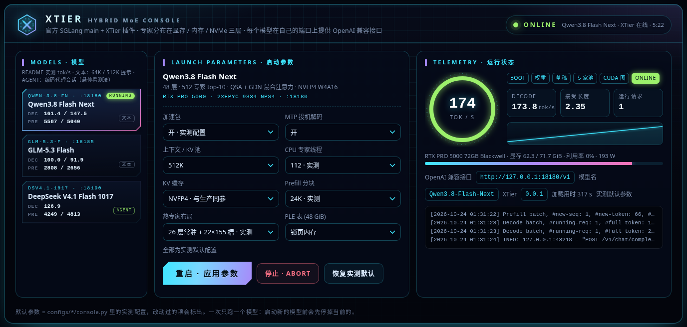

# XTier

[English](docs/README.en.md) · [文档目录](docs/README.md) · [快速开始](docs/quickstart.md) · [支持情况](docs/support.md)

XTier 是官方 [SGLang](https://github.com/sgl-project/sglang) 的插件（跟 main 分支），做 CPU/GPU 分层 MoE 推理：专家分布在显存和内存两层，按热度放置、按需调度；NVMe 只放大嵌入表的行（DeepSeek 的 Engram、Qwen 的 PLE）。内存放不下全部专家时，可选的冷专家池把少用的专家放到硬盘、用到时读回内存，池子大小和速度受限于硬盘速度和类型。

**状态：早期开发**（[工作计划](docs/PLAN.md)）。Inkling-2-Small、Hunyuan-4-Flash NVFP4、DeepSeek V4.1 Flash 1017、Qwen3.8 Flash Next、GLM-5.3 Flash 跑在 SGLang main 上；MiniMax-M3.1-Flash 跑在 SGLang 的 M3.1 分支（PR #45925），已暂停开发（本机太慢、智力不强）。

- **不改 SGLang 源码**：只用官方插件框架的钩子（接在官方 KTransformers 混合推理的入口上），加载后自检是否接管成功。
- **与模型无关**：混合推理包在官方 `FusedMoE` 的量化方法外面，用标准 MoE 层的模型装上就能跑（NVFP4、MXFP4 专家）。
- **加速包可选**：某个模型独有的修正和内核放在 `xtier/packs/` 下。

## 结构

```
xtier/
├── backend/   混合 MoE 后端：接管官方量化方法，权重加载完即交给 CPU 引擎；解码走信箱（CUDA 图可捕获），prefill 走 GPU 分组 GEMM 或 CPU
├── cache/     热专家缓存：每层槽数可不同，全部常驻的层不经过 CPU；自适应换入换出；常驻层的 prefill 直接在槽上算；
│              第二张卡当热专家池（可选，`XTIER_GPU2_SLOTS`）
│              冷专家池（可选，`XTIER_COLD=1`）：少用的专家放到硬盘（[设计](docs/design-cold-experts.md)）
├── planner/   规划器：本机探测的 GPU / CPU 耗时 + 路由档案 → 显存预算内每层的热专家槽数（按 CPU 和 GPU 同时算完分配），可在启动时自动算
├── engine/    CPU 引擎的 Python 绑定、绑核、锁页内存（C++ 源码在 csrc/）
├── packs/     加速包：inkling2（40 NVFP4 + 8 MXFP8 MoE + SiTU、NVFP4 目标 KV 6.75 GiB/512K 与远区无掩码解码核、全局注意力 3 流切片投影、116 层 FP8/W8A8、无损 DSpark 在线截断与零内存全驻 GPU 层）、
│              hy4_flash（混合 SWA+DSA 池、416 B/tok NVFP4 KV 与 L2 聚簇解包、FP8 IndexPool、Engram 放 NVMe、零补丁原生 5 层 DFly2 投机解码与置信度截断）、
│              qwen4_exp（PLE 表、PLE 行放 NVMe、hc_mix 重叠内核、QSA 读 NVFP4 KV）、glm5_next（量化排除、DSA、NextN）、
│              deepseek_v4（Engram 行放 NVMe 与跨块预热、SM120 mHC 精确核与 MXFP8 预填自调优、候选索引器、FP8 wo_a、分页索引器、DSpark 上下文草稿检索）、
│              minimax_m3（SM120 通用栈、CUDA 上的 DSpark verify、草稿词表头 FP8、SM120 上读 NVFP4 KV）、
│              speculative（通用投机解码：EAGLE 的热词表配无损拒绝采样、草稿温度、按置信度截断验证；DSpark 按置信度截断验证）
├── tables/    大嵌入表的行放在 NVMe：多段多文件、任意行宽、行缓存、CUDA 图内查表
├── console/   启动台：一个网页选模型、调启动参数、启动 / 停止，跟踪加载阶段与 decode 遥测（只用标准库）
└── platform.py  与模型无关的主机修正（TileLang 目标选择）
csrc/          CPU 引擎：AVX-512 / AVX2 专家内核、NUMA 线程池、CPU 与 GPU 之间的信箱通信
configs/       每个"模型 × 硬件"的启动配置，console.py 是它在启动台里的条目（选项、默认值、启动命令）
tests/         单层测试（引擎、信箱、缓存、prefill、格式适配、hc_mix、投机截断、QSA NVFP4、GPT-OSS SwiGLU、wo_a、MiniMax NVFP4 KV、快速加载、未命中代算）、启动台与规划器检查
tools/         构建、内存看门狗、规划器（plan_probe 探测、plan_trace 路由档案、plan_auto 出方案、plan_calibrate 校准，见 docs/planner.md）
bench/         验收脚本（PPL、照抄、验证步、并发、prefill 延迟）与结果
```

## 快速上手

从空机器到第一次请求的完整路线（环境、模型准备、启动命令、测试请求）见[快速开始](docs/quickstart.md)。已经有 SGLang 环境时：

```bash
git -C /path/to/sglang checkout 4ce41378f9      # 测试过的官方 SGLang main（2026-11-21）
SGLANG_BUILD_RUST_EXTS=none pip install -e /path/to/sglang/python   # 没装 Rust 时跳过 SGLang 可选的 Rust 扩展
tools/build_engine.sh /path/to/site-packages/nvidia/cu13   # CPU 引擎与信箱库 -> xtier/engine/lib
pip install --no-deps -e .                      # 注册插件入口 sglang.srt.plugins: xtier
python tools/check_sglang.py --strict           # 不用模型：核对 SGLang 的提交、XTier 的钩子目标和 import
XTIER=1 XTIER_THREADS=112 XTIER_MAIN_CPUS=auto XTIER_CACHE_SLOTS=155 \
  python -m sglang.launch_server --model-path <MoE 检查点> --cuda-graph-backend-prefill disabled ...
```

XTier 跟着官方 SGLang main 走，每次只认一个测试过的提交（[xtier/__init__.py](xtier/__init__.py) 的 `SGLANG_COMMIT`，更新时写进
版本更新）；装的 SGLang 不是这个提交时，启动日志会警告，`tools/check_sglang.py` 列出挂不上的钩子（加 `--strict` 时提交不同也算失败）。
依赖的版本见 [constraints.txt](constraints.txt)。

开关见 [xtier/config.py](xtier/config.py)；按模型和硬件的完整启动参数见 [configs/](configs/)，也可以用下面的启动台。

快速加载（可选，`XTIER_FAST_LOAD=1`；默认关，即 SGLang 原来的加载方式）：专家直接从模型文件（开冷专家时从冷存储）读进
CPU 引擎，全部读完、检查完才报在线，DeepSeek V4.1 Flash 1017 启动 472 → 186 s（[报告](docs/reports/2026-10-27-fast-load.md)）。
MoE 张量并行（`--tp-size` > 1）时每个 rank 只读自己那份（双 RTX 4090 实测 Qwen3.8 权重加载 170 → 133 s，分片与普通加载逐字节相同）。

## 启动台



在仓库根目录运行 `python3 -m xtier.console`（只用 Python 标准库），打开 http://127.0.0.1:8100/ ：

- **左边模型栏**：每个模型一张小卡片，写着端口和 README 实测速度，标签注明测法（AGENT = agent 速度，文本 = 文本速度），
  模型多了在栏内滚动。
- **中间启动参数**：默认就是实测配置，改过的项会标出。公共的有加速包开关（关 = 测速表里的「基线」）、投机解码、上下文、
  CPU 专家线程，其余是各模型自己的（热专家槽、分块、弹性热专家、冷专家卸载、未命中专家 GPU 代算等）。
- **右边运行状态**：加载阶段（权重 → 草稿 → 专家池 → CUDA 图 → 预热 → 在线），在线后显示 decode 速度、接受长度、显存和日志。

一次只跑一个模型；模型服务在自己的端口上提供 OpenAI 兼容接口，启动台退出不影响它。加模型只要在 `configs/<模型>-<硬件>/` 里
加一个 `console.py`（卡片、选项、启动命令）。细节见 [docs/console.md](docs/console.md)。

## 支持的模型

| 模型 | 官方模块 | 状态 |
|---|---|---|
| Inkling-2-Small（594B / 17B active，多模态） | `inkling2` | 官方 main 上跑通（512K KV 池 / 2 并发，含零补丁 5 层 DSpark + 无损在线截断 0.20 + 23 层 ViT 多模态）：默认方案 A+（2% NVMe 冷尾 `376/384` 专家在内存，45 弹性热槽，64K 单块 prefill `3,835 tok/s`、`2.41×` 提速，短文 `bs=1 74.7` / `bs=2 78.4 tok/s`，512K NVFP4 KV 仅占 `6.75 GiB` 完整解锁 500K），另提供无冷专家方案 B2（仅 `L47` 全驻 GPU，48K 分块 `2,846 tok/s`）；13 段 PPL `ΔNLL +0.00423` / `KL 0.00938`，照抄 `0/8`，256K/500K 5 深度捞针全 `5/5` |
| Hunyuan-4-Flash NVFP4 | `hy4_flash` | 官方 main 上跑通（1M KV 池 / 1M 上下文 / 4 并发，含零补丁原生 5 层 DFly2 投机解码 + 置信度截断）：混合 SWA+DSA NVFP4 KV（`7.95 GB`，较基线省 `24.37 GB`）、FP8 IndexPool、Engram（64.7 GB）放 NVMe、208 层 FP8/W8A8 与共享专家掩蔽，照抄 0 错、PPL 无损 |
| Qwen3.8 Flash Next | `qwen4_exp` | 官方 main 上跑通：精度、照抄、512K 召回与生产一致；加速包比基线 冷 prefill 快 5% / 24%（64K / 512K）；KV 存 NVFP4（与生产同参，加速包让官方 QSA 能读），省下的显存用来多放常驻层，启动台默认由规划器自动布局；PLE 表（48 GiB）可放 NVMe，放傲腾时速度与锁页表持平 |
| GLM-5.3 Flash | `glm5_next` | 官方 main 上跑通（含 EAGLE）：加速包（FP8 权重、热词表拒绝采样、截断验证、弹性热专家槽）比基线 长回复每步快 22%，PPL 3.987 → 3.998 |
| DeepSeek V4.1 Flash 1017 | `deepseek_v4` | 官方 main 上跑通（含 DSpark）：Engram 表（189 GB）的行放 NVMe（[设计](docs/design-tables-nvme.md)），照抄 0 错；加速包（含 FP8 wo_a、分页索引器、弹性热专家槽）比基线 长回复每步快 39%、冷 prefill 快 33% |
| MiniMax-M3.1-Flash | `minimax_m3` | **暂停开发**（2026-10-26，本机太慢、智力不强）。SGLang 的 M3.1 分支（PR #45925）上跑通（含 DSpark），加速包比官方代码长回复每步快 34% |

## 支持的显卡

每个模型、显卡和多卡模式实际验证到什么程度（整模型、截层、单层、模拟）见[支持情况](docs/support.md)。

| 显卡 | 状态 |
|---|---|
| Blackwell（SM120） | 开发和测速平台（RTX PRO 5000 72 GB），下面的测速都在这上面测；另已在 RTX PRO 6000 Blackwell 96 GB（Colab G4）上实测 Qwen3.8 整模型（含 MTP，照抄 0/8）与全量免模型单测 |
| Ada / RTX 40 系 & L4 / L20（SM89） | 支持（含社区贡献的 `2×L20 TP=2` DeepSeek V4.1 配置，见 [configs/ds41-l20-tp2/](configs/ds41-l20-tp2/README.md)）。RTX 4090 实测：Qwen3.8 整模型在单卡 24 GB + 120 GB 内存上照抄 0 错、120K 上下文（[配置](configs/qwen38-rtx4090-3090/README.md)）；GLM-5.3 截层、DeepSeek V4.1 单层测试通过，整模型在本机模拟验证；GLM 要关投机解码（[报告](docs/reports/2026-10-29-rtx40.md)）。另已在 NVIDIA L4 24 GB（50% SSD 冷专家）上实测 Qwen3.8 整模型与全量免模型单测 |
| Ampere / RTX 30 系（SM86） | 支持。RTX 3090 实测：Qwen3.8 整模型在单卡 24 GB 上照抄 0 错、120K 上下文，decode 约 42 tok/s（云主机 28 个 CPU 线程）；GLM-5.3 截层、DeepSeek V4.1 单层测试通过，整模型在本机模拟验证。FP8 全部软件解码（与硬件逐位相同），GLM 用 BF16 KV、要关投机解码。详见[报告](docs/reports/2026-10-29-rtx30.md) |
| Ampere / A100（SM80） | 支持。NVIDIA A100 40 GB 实测：Qwen3.8 整模型（含 MTP=0/1，110 槽 + NVMe PLE）照抄均 0/8，全量免模型单测通过。FP8 权重与 KV 全部软件解码（与硬件逐位相同）；首次启动 Marlin FP8 PTX JIT 约需 6–7 分钟，后续复用缓存 |

## 多卡（张量并行）

两张卡用张量并行（`TP=2`）：每张卡放每个热专家的一半和一半 KV，每卡能放的热专家槽数是单卡的三倍多；CPU 引擎每个 rank 一个进程，
各用自己 GPU 那组 NUMA 节点（每颗 CPU 带一张卡时正好一卡一 CPU）。两卡之间不需要 P2P / NVLink，SGLang 会自动改走 NCCL。
双 RTX 3090 实测 Qwen3.8：decode 42.1 → 59.6–61.7 tok/s（+42–48%，开 MTP 69–72 tok/s），120K 首字 72.6 → 47.0 s，照抄 0 错。
两张卡显存不一样大时，SGLang 默认拒绝启动，加 `SGLANG_ENABLE_TP_MEMORY_INBALANCE_CHECK=0` 可以跑，但两张卡都只能按小卡的显存放
（24 + 16 GiB 实测每层 64 槽，decode 51 tok/s）。
用法见[配置](configs/qwen38-rtx4090-3090/README.md#two-gpus-tp2)，详见[报告](docs/reports/2026-10-30-tp.md)。

### 异构卡：快卡带慢卡，第二张卡纯当热专家池

两张卡显存或速度不同时，TP 只能按小卡、慢卡的节奏跑。第二张卡可以不放模型，只放热专家（`XTIER_GPU2_SLOTS`，默认关）：

```
XTIER_GPU2_SLOTS=auto CUDA_VISIBLE_DEVICES=快卡,慢卡 bash configs/qwen38-rtx4090-3090/run-qwen.sh
```

- **做法**：主卡没命中、第二张卡有的专家由它算，结果经内存加回 CPU，不需要 P2P；prefill 只用主卡。
- **分配**：`auto` 留 1.5 GiB，其余显存放专家，分工自动调整。
- **精度**：Qwen、GLM、DeepSeek 单层结果和主卡逐位相同。
- **限制**：只支持 `TP=1`，不能和冷专家同用；主卡有硬件 FP4 解码时第二张卡也要有。

测速只比较四种用法：同规格卡 TP、异构卡 TP、同规格卡热池、异构卡热池，单卡作基准。都用 RTX 4090 模拟（Qwen3.8，单请求，输出 512 token），方法见报告。

| 配置 | 每层热专家槽 | 32K decode tok/s | 120K decode tok/s | 120K 首字 |
|---|---|---:|---:|---:|
| 单卡 24 GiB（基准） | 48 | 41.0（100%） | 43.6（100%） | 60.9 s（100%） |
| 同规格卡 TP 24 + 24 GiB | 180（半个专家） | 62.1（151%） | 63.4（145%） | 68.9 s（88%） |
| 异构卡 TP 24 + 16 GiB | 64（半个专家） | 51.1（125%） | 49.4（113%） | 60.0 s（101%） |
| 同规格卡热池 主 24 + 热池 24 GiB | 48 + 178 | 58.2（142%） | 56.2（129%） | 59.3 s（103%） |
| **异构卡热池 主 24 + 热池 16 GiB** | **48 + 113** | **57.3（140%）** | **55.9（128%）** | **58.9 s（103%）** |
| 异构卡热池 主 24 + 热池 16 GiB，热池卡耗时约 1.2 倍 | 48 + 113 | 54.5（133%） | 54.2（124%） | 59.0 s（103%） |

括号是相对单卡的速度，首字按耗时反算。异构卡热池比异构卡 TP 快 12–13%；同规格卡 TP 的 decode 最快。

热池不参与 prefill，首字 103% 不是加速；同规格卡 TP 的 88% 是那次 prefill 卡了约 9 s。

只看趋势：这台 CPU 偏弱，CPU 越强第二张卡省得越少；真实异构卡还没测过，DeepSeek 和 GLM 只测了单层和截层。

照抄：开启时 9 次启动有 3 次翻同一个 token，其余 0 错；单卡反复重算提示词 KV 也会翻。详见[报告](docs/reports/2026-10-31-second-gpu-pool.md)。

## 测速

单卡 RTX PRO 5000 72GB + 2× EPYC 9334（NPS4）+ 384 GiB DDR5，单位 tok/s，只放最新一次的结果。DeepSeek 加速包各行是 2026-11-24 重测的（SGLang main 4ce41378f9，24-token 权重复用 decode、写回融合、43 层 FP8 wo_a、全双工 FP4 预填与非末块跳尾、Engram 跨块预热、DSpark 上下文草稿检索、同时跑 4 个请求），其余各行是 XTier 跟 SGLang main 8cd3c494 时
（2026-10 下旬）测的，后面的版本没有重测，每个版本只回归三个模型的 64K / 520K 速度、精度和真实任务（最近一次见[报告](docs/reports/2026-11-19-lossless-9k-prefill.md)）。

用 [bench/agent_bench.py](bench/agent_bench.py) 模拟编码代理：5 个会话从 64K 到约 500K，铺满 512K KV 池，多步调用工具，同一次启动
连跑两轮。冷 prefill = 会话第一个请求里未命中缓存的 token / 首字，decode 只算长回复（≥ 300 token）。基线 = 启动台「关加速包」：
官方 SGLang main 加 XTier 的混合推理和跑起来必需的修正，不开提速项，**不是原版 SGLang**。配置、精度和原始数据见[测速细节](docs/benchmarks.md)。

### Inkling-2-Small（594B / 17B active，多模态）

RTX PRO 5000 72 GB · 512K 上下文 / 2 并发（40 NVFP4 + 8 MXFP8 MoE，40 SWA + 8 全局注意力，23 层 ViT 多模态，原生 5 层 DSpark）：

| 模式 | 启动耗时 | 单路 decode（bs=1） | 2 并发合计（bs=2） | 64K 冷 prefill | 64K 缓存 decode | 256K 冷 prefill | 500K 冷 prefill | 500K 缓存 decode |
|---|---:|---:|---:|---:|---:|---:|---:|---:|
| **XTier + 加速包（方案 A+，启动台默认：`cold=2%`, 45 槽, 64K）** | **126 s** | **74.7**（首轮 81.7） | **78.4** | **3,835**（17.1 s） | **52.6**（稳态峰 **66.7**，42.0 ms） | **2,464**（106.4 s） | **1,593**（313.9 s） | **43.7**（峰 47.0，53.8 ms） |
| XTier + 加速包（方案 A 稳妥档：`cold=8%`, 44 槽, 64K） | 120 s | 71.1（峰 77.2） | 79.0–83.3 | 3,815（17.2 s） | 58.5（峰 63.5，45.1 ms） | 2,465（106.3 s） | 1,603（311.8 s） | **47.0**（峰 51.1，53.7 ms） |
| XTier + 加速包（方案 B2 无冷专家：仅 `L47` 全驻, 35 槽, 48K） | 420 s | 82.9（首轮） | 72.6 | 2,846（23.1 s） | 56.8（峰 62.5，40.1 ms） | 2,215（118.3 s） | 1,512（330.7 s） | 40.1（峰 47.4，56.6 ms） |
| **基线（关加速包，默认跑通：`W4A16/W8A16, BF16 KV, 16K, 27 槽`）** | ~390 s | 47.9 | ~43 | 1,591（41.3 s） | 43.4（82.3 ms） | 1,217（215.3 s） | OOM | OOM |

加速包对基线：64K / 256K 冷 prefill 提速 **`2.41×` / `2.02×`**，短文单路 / 2 并发 decode 提速 **`+56%` / `+82%`**，512K Target NVFP4 KV（`6.75 GiB`，`3.56×` 压缩）配远区无掩码解码核彻底解锁 **500K 上下文**；完整两轮 `agent_bench`（64K→513K，91/91 请求命中缓存）长回复 **`66.2 tok/s`**（全部 33 可计时请求 **`66.3 tok/s`**，接受长度 **`4.02`**，`60.6 ms/步`）。默认方案 A+ 将 **376/384（97.9%）** 专家放内存（仅 2% 约 `7 GiB` 最冷尾放 4 盘 NVMe，Decode 读盘仅 `0.2–0.7` 专家/步、保留 `12–15 GiB` 系统可用内存、稳态显存 `70.65 / 73.4 GiB` 零 OOM 重试），`cold=off` 可切至纯内存+显存方案 B2（仅 `L47` 占 `11.75 GiB` 全驻 GPU 零内存）。精度全检通过：13 段 PPL/KL 对比基线 `ΔNLL +0.00423`、`KL 0.00938`，`copy_test` 照抄 `0/8`，256K / 500K 5 深度捞针全 `5/5`，思考 / 工具调用 / 视觉多模态均正常。

### Hunyuan-4-Flash NVFP4

RTX PRO 5000 72 GB · 1M KV 池 / 1M 上下文 / 4 并发（混合 SWA+DSA NVFP4 KV `7.95 GB`、208 层 FP8/W8A8、共享专家掩蔽、Engram NVMe 32 GiB L1 优先直映、152→289 弹性槽、48K 分块）：

| 模式 | 单路 decode（bs=1） | 4 并发合计（bs=4） | 100K 召回 prefill | 4×128K 并发 prefill | 876K–950K 冷 prefill | 超长缓存 decode |
|---|---:|---:|---:|---:|---:|---:|
| XTier + 加速包 + **DFly2（默认，截断 0.20）** | **92.1**（稳态 124–152，照抄 306） | **186.8–190.4**（稳态 209–226） | 3,630（PASS） | 3,565 | 3,454（876K） | **87.5–110.8**（876K 稳态） |
| XTier + 加速包（无投机） | 70.0（稳态） | 197.5–202.4（稳态） | 3,858（PASS） | 3,565 | 3,466（950K） | 68.6（950K 稳态） |
| 初次跑通基线（全量 FP8 KV `32.32 GB`，BF16 稠密层） | 55–56（稳态） | 148–162（稳态） | 3,657（PASS） | — | 3,084（950K） | 43.8（950K 壁钟） |

零补丁原生 5 层 DFly2 投机解码通过 `SpeculativeAlgorithm.register('DFLY')` 注册，内置融合 group-128 FP8 草稿 `lm_head` 与零分配 Triton 置信度截断（默认 `XTIER_DSPARK_TRUNCATE=0.20`，验证无损）：`bench/decode_speed.py` 混合推理/代码单路均速 92.1 tok/s（代码/文本稳态 124–152 tok/s，峰值 175 tok/s），`bench/copy_test.py` 照抄 `0/4` 差、接受长度 `5.80–5.84`、双路达 **298.8–306.1 tok/s**，PPL 100% 无损（`all nll = 2.329`），876K 缓存 decode 零 OOM 重试。

### DeepSeek V4.1 Flash 1017

| DSpark | 轮 | 冷 prefill 64K 会话 | 冷 prefill 500K 会话 | decode（长回复） | 接受长度 | 每步 |
|---|:-:|---:|---:|---:|---:|---:|
| XTier + 加速包 | 1 | 5,969 | 9,038 | 156.6 | 4.64 | 29.6 ms |
|  | 2 | 7,967 | 9,023 | 154.7 | 4.65 | 30.1 ms |
| XTier + 加速包，4 个请求同时（合计） | — | — | — | 268 | 3.40 | 51.0 ms |
| 基线（关加速包） | 1 | 3,318 | 3,627 | 65.5 | 3.25 | 50.9 ms |

加速包对基线：长回复两轮合计 155.4 对 65.5 tok/s（每步 29.9 对 50.9 ms，快 41%；同会话 64K / 128K 长回复为 157.8–162.2 tok/s、每步 28.8 ms，第 2 轮因 384K 会话推进至 488K 上下文连续写长文件使两轮长回复加权上下文升至 234K / 282K），冷 prefill 64K / 500K 两轮均值 6,968 / 9,030 对 3,318 / 3,627（快 110% / 149%；500K 两轮双双突破 9,000+ tok/s，128K / 256K / 384K 会话分别达 8,449–8,714 / 8,844–8,931 / 8,927–8,966 tok/s，稳态 48K 单块达 9,806–9,999 tok/s）；两轮全部 127 个请求（含工具调用）合计 decode 163.9 tok/s、接受长度 4.74、每步 28.9 ms，500–900 token 工具回传首字约 1.1 s；精度 100% 无损（13 段 PPL 的 NLL 1.2001 对基线 1.1996），照抄正文 0 错（偶尔在一段末尾多输出一个 `</src>`，原来就有）。第三行是 4 个各约 16K token 的提示同时从零新写 3,000 token，decode 是 4 个请求合计（每个 62–69 tok/s；基于原文件改写 / 编辑时合计 332–382 tok/s），接受长度和每步是这 4 个请求的；2 个同时新写合计 195.8 tok/s（每步 37.4 ms），单请求每步 26.6–28.2 ms。

**无损 24-token 权重复用 decode、写回融合、43 层 FP8 `wo_a`、Eager MXFP8 快分发与非末块跳尾：500K 冷 prefill 两轮双破 9,000 tok/s、4 路并发升至 268 tok/s、160K 冷 prefill 快 14.4%（2026-11-24）。** 在 100% 精度无损且零 SGLang 源码改动前提下继续压榨关键路径：①单槽扩容至 `SLOT_TOKENS=24`（`SLOT_ROUTES=144`、`DECODE_M=24`），`17..24` 行走权重复用 `_gate_up_2x16` / `_down_2x16` 核（消除 `bs=3/4` 下 `16+2`、`16+8` 双轮拆分），共享暂存仅增约 35 MiB，完整保住全部 `+26` 弹性热专家槽（共 61 活跃槽），61 槽稳态 `M=18` 验证步从 `57.5` 降至 `45.0 ms`（−21.8%）、`M=24` 从 `80.0` 降至 `71.4 ms`（−10.8%）；②Decode 热路径 `_down` 升级 `dbn=128` + `TOK_MASK` 稀疏写回、`_commit` 256 路并行、全常驻层 `_pack` 单 CTA 快路径、`_combine`/`_unpack` 融合 `BF16` 与缩放因子乘法（每步省 83 次逐元素核），并补齐草稿模型 3 层 `wo_a` 无损 FP8（主模型 40 层 + 草稿 3 层共 43 层全量 FP8）：单路 `recall` 升至 `212.0–212.5 tok/s`（`28.2 ms`/步），同温 `bs=1` 推理步时 `26.82 → 26.60 ms`；③Eager 预填直调 `mxfp8_quantize_sm100` 并缓存 `b12x` 编译核（分发开销 `121 → 10 µs`，切换阈值提至 `768`）、`shared_experts` 复用 MoE 预量化激活、48K 分块在显存充裕时合为 1-band `_reduce_band`、`hybrid_prefill` 独立 D2H 流提前唤醒 CPU 线程，并在非末块 `L20` 写完压缩源 KV 后安全跳过 `L21..39` 尾循环：160K 冷 prefill 从 `20.43 s`（`7,833 tok/s`）加速至 **`17.86 s`（`8,961 tok/s`，+14.4%）**，首个 16.5K 预填 `4.22 → 3.81 s`（−9.7%），`286–594` token 增量预填快 `2–5%`；并发 `1/2/4` 照抄均 `0/8` 正文差、160K 三针跨跳尾块 100% 召回、13 段 PPL 无损（NLL `1.2001`）。

**保持 48K 默认分块不变，冷 prefill 384K–500K 跃升至 8,894–9,085 tok/s、第 2 轮 64K 升至 7,713 tok/s，工具回传快 1.86 倍（2026-11-19）。** 在 48K 分块 + Engram 跨块预热（[v0.1.7 报告](docs/reports/2026-11-18-lossless-prefill-recall.md)）基础上，不改任何分块或精度，纯靠管线与算子去掉剩余阻塞：①通用层 `_run_fp4` 将 `UE8M0` 权重缩放一次性预重排在锁页内存，清空 `_copy_stream` 上每块 3,840 次 GPU 核、扩至 24 个纯 DMA 暂存槽跨 Attention 窗口并发传输，并用 L2 驻留位图规约、零同步分带直方图（消除 `torch.bincount` 每块 200 次隐式流同步）、保序单遍 `_reduce_band` 与 `_d2h_stream` 全双工 `CPU_SHARE` 交叠替换原先的基数排序与多遍原子写；②通用层 `engine.cpp` 对 `m > 16` 放开动态工作窃取与线程私有 L2 缓冲，配合 640 token 混合预填阈值与并行 BPE 分词（68 万 token 1.57 → 0.21 s），把 743 token 工具回传首字从 2.07 s 压到 1.12 s；③DeepSeek 加速包在 SM120 上补齐 PTX 精确 `mhc.post`（60.1 → 4.4 ms，消除 48K 分块下 +22.5 GiB 广播显存尖峰）、激活 24-bit 精确 `bf16x3` mHC 投影、为 `>=512` 行开启自调优 CUTLASS MXFP8 投影、新增 L2 分组 BF16 `wo_a` 预填核并跳过非末尾块的冗余 SWA 边界重放。见[报告](docs/reports/2026-11-19-lossless-9k-prefill.md)。

**decode 长回复每步 28.8 ms，上下文草稿检索（Recall）使全量请求达 180.4 tok/s、4 路改写编辑达 332–382 tok/s（2026-11-18）。** FP8 投影的小批量快内核覆盖 1–32 行、`wo_a` 分组投影放宽到 64 行、DSpark 草稿头单行补齐走 Tensor Core，把单路和 4 个请求合批验证的长回复每步压到 28.8 ms（[算子拆解](docs/reports/2026-11-11-decode-step.md)）。同时启动台默认开启「上下文草稿检索」（`XTIER_RECALL=1`）：在内存里给当前会话的上下文和近期输出建滚动哈希，一旦模型开始写上下文里出现过的路径、变量名或代码段，就把后续连续 token 填进草稿槽交给主模型逐词验证——输出 100% 无损，没命中时不发任何额外 GPU 内核。表里的「长回复」（153.5–154.0 tok/s）和第三行的 4 路同时新写（258 tok/s）都是在从零写新内容，几乎不触发检索；而 `agent_bench` 里的工具调用大量引用已有路径和代码片段，单会话冲到 233–258 tok/s，把两轮全部 159 个请求拉到 180.4 tok/s（每步 26.5 ms）；4 个请求同时基于原文件做改写或局部编辑时（如多子 agent 并发改代码），草稿大量命中原文件片段，4 路合计实测为 332 tok/s（混合改写与编辑）到 382 tok/s（多轮局部微调），即 332–382 tok/s。见[报告](docs/reports/2026-11-18-lossless-prefill-recall.md)。

### Qwen3.8 Flash Next

| MTP | 轮 | 冷 prefill 64K 会话 | 冷 prefill 500K 会话 | decode（长回复） | 接受长度 | 每步 |
|---|:-:|---:|---:|---:|---:|---:|
| XTier + 加速包 | 1 | 5,715 | 5,170 | 181.7 | 2.57 | 14.2 ms |
|  | 2 | 5,610 | 5,150 | 207.2 | 2.68 | 13.0 ms |
| 基线（关加速包） | 1 | 5,319 | 4,078 | 139.5 | 2.13 | 15.2 ms |

加速包（规划器自动布局）对基线：每步 13.6 对 15.2 ms（快 11%），冷 prefill 64K / 500K 快 6% / 27%；精度轻微损失
（KV 存 NVFP4，与生产相同），PPL 3.481，照抄 0 错。

### GLM-5.3 Flash

| EAGLE | 轮 | 冷 prefill 64K 会话 | 冷 prefill 500K 会话 | decode（长回复） | 接受长度 | 每步 |
|---|:-:|---:|---:|---:|---:|---:|
| XTier + 加速包 | 1 | 2,648 | 2,640 | 96.3 | 2.54 | 26.4 ms |
|  | 2 | 2,715 | 2,635 | 98.2 | 2.66 | 27.1 ms |
| 基线（关加速包） | 1 | 2,663 | 2,518 | 76.8 | 2.61 | 34.4 ms |

加速包（58 槽 + 弹性热专家槽）对基线：每步 26.9 对 34.4 ms（快 22%），冷 prefill 64K / 500K 快 1% / 5%；精度轻微损失
（注意力 / 稠密层存 FP8，PPL 3.987 → 3.998），照抄 0 错。

### MiniMax-M3.1-Flash（暂停开发）

| DSpark | 轮 | 冷 prefill 64K 会话 | decode（长回复） | 接受长度 | 每步 |
|---|:-:|---:|---:|---:|---:|
| XTier + 加速包 | 1 | 1,854 | 53.4 | 3.04 | 56.9 ms |
|  | 2 | 1,877 | 50.0 | 2.70 | 54.0 ms |
| 官方代码 + 必要修正 | 1 | 1,824 | 46.8 | 3.94 | 84.3 ms |
|  | 2 | 1,883 | 45.5 | 3.82 | 84.0 ms |

SGLang 的 M3.1 分支（PR #45925），固定 512K，只跑 64K 会话；加速包对官方代码 + 必要修正每步 55.4 对 84.1 ms（快 34%）。

## 冷专家卸载到硬盘

内存放不下全部专家时，每层只把一部分专家放内存，其余放 NVMe 上的冷专家池，路由到时读回内存再算（`XTIER_COLD=1`，默认关，
[设计](docs/design-cold-experts.md)）。一次缺失所有盘同时读，速度主要看盘。启动台的 DeepSeek 卡片可选卸载 10% / 20% / 30%。

四个模型都按卸载 30% 跑过端到端回归（照抄 0 错、dsh 15 分钟 0 失败，当时是 4 块 PCIe 4.0 盘）：

| 模型 | 每层在内存的专家 | 所需内存（不卸载 → 卸载 30%） |
|---|---|---:|
| DeepSeek V4.1 Flash 1017 | 269 / 384 | 298 → 224 GiB |
| GLM-5.3 Flash | 202 / 288 | 174 → 129 GiB |
| Qwen3.8 Flash Next | 358 / 512（只卸载 CPU 上的 18 层） | 121 → 116 GiB |
| MiniMax-M3.1-Flash | 90 / 128 | 227 → 165 GiB |

### DeepSeek V4.1 Flash 1017：卸载比例与速度

4 块 PCIe 5.0 盘（三星 9100 PRO，四盘同读 50.6 GB/s），agent_bench 的 64K 会话，单次运行（±5–10%）：

| 卸载 | 放到硬盘 | decode 每步 / tok/s | 64K 冷 prefill（tok/s） |
|---|---:|---|---|
| 不卸载 | 0 | 30.0 ms / 142 | 4,300 |
| 10% | 27 GiB | 31.6 ms / 135（−5%） | 3,784（−12%） |
| 20% | 54 GiB | 34.4 ms / 124（−13%） | 3,742（−13%） |
| 30% | 81 GiB | 37.9 ms / 112（−21%） | 3,731（−13%） |
| 40% | 108 GiB | 44.5 ms / 96（−32%） | 3,672（−15%） |
| 50% | 134 GiB | 53.5 ms / 80（−44%） | 3,537（−18%） |

盘要先测几分钟的持续读：无 DRAM 的盘（如 HP FX700）满速读约 100 秒后会掉到约 60 MB/s，拖住整个池子。明细见[报告](docs/reports/2026-11-01-cold-pcie5.md)。

### 大模型只存一份

冷存储本来就存全部专家，`tools/cold_punch.py` 逐字节核对后，把模型文件里的这部分打洞释放（`--restore` 可写回）：DeepSeek V4.1 Flash 1017
290 → 21 GiB。代价：冷存储成了唯一一份，盘坏了要重新下载模型；没有 XTier 的 SGLang 不能再加载这个目录。

### 可选项（默认关）

- **盘数不是 4 块或盘速不一样**：`XTIER_COLD_UNITS=3` 按盘速分配（如 `XTIER_COLD_PARTS=5:5:5:5:2:2`），已有的存储用
  `tools/cold_relayout.py` 换布局。[报告](docs/reports/2026-11-06-cold-units-tail-skip.md)
- **尾部跳过**（会改变输出）：`XTIER_TAIL_SKIP=5/6`（保留/总共），decode 时 CPU 算的专家没被任何 token 排进前 5 名就跳过。DeepSeek
  不卸载时每步只快 2.3%，专家大多在盘上时收益大。[报告](docs/reports/2026-11-06-tail-skip-cpu.md)

### 最小化运行：32 GB 显存 + 128 GB 内存跑 DeepSeek V4.1 Flash 1017

模拟一张 RTX 5090：32 GB 显存、128 GB 内存都是硬上限，冷专家 70%，冷存储是 4 块 PCIe 4.0 盘（启动台卡片「DeepSeek V4.1 Flash 1017 ·
最小化」）。速度约为正常配置的 25%，瓶颈在读盘，详见[报告](docs/reports/2026-10-27-ds41-minimal.md)。

| 单位 tok/s | 32K | 64K | 128K |
|---|---:|---:|---:|
| prefill（32 GB + 128 GB） | 1,186 | 1,165 | 1,155 |
| decode（32 GB + 128 GB） | 28.5 | 28.1 | 32.7 |
| prefill（正常配置） | 3,886 | 4,609 | 4,655 |
| decode（正常配置） | 130.7 | 127.9 | 122.4 |

## 版本更新

- 2026-11-25（v0.1.10）：新增 **Thinking Machines Inkling-2-Small（594B / 17B active，多模态）** 完整零补丁加速包与启动台卡片，并打包合入 11-24 的 DeepSeek V4.1 全链路无损 9K+ 优化。Inkling-2 特性：①CPU 引擎与信箱新增 MXFP8 + SiTU（4.0/25.0）支持，零内存全驻 GPU 层路径（`XTIER_CACHE_FULL` 无冷专家时跳过 host 内存拷贝）；②Prefill 启用 NVFP4 `W4A4 4over6 MAE` + MXFP8 `W8A8` cuDNN、116 层全量 FP8/W8A8（修复 `fp8_weights` `tl.int64` 大矩阵溢出）与 Global Attention 3 流切片投影（减 `2.6×` 计算、省 `3.3 GiB` 显存）；③Target 48 层 NVFP4 KV（`72 B/head`，512K 仅 `6.75 GiB`）+ 远区无掩码解码核（500K 注意力 `14.70 → 11.31 ms`）+ FA4 `_shear_bias_workspace` 精准回收；④Hook `_mix_norm` 绕过上游 SGLang Triton `int32` 溢出解锁 **64K 单块 Prefill（`BATCH=65664`，`3,835 tok/s`）**，接入零补丁 DSpark `OnlineAcceptanceEstimator` 在线截断（`0.20`）与 Recall；⑤修复 `_copy_stream` 异步 DMA UAF 与 `cold.relink()` 字母序预读链（GPU Prefill NVMe 等待 `0.0 s`）；⑥启动台新增每模型 `guard_gib` 配置，默认 **方案 A+**（`cold=2%`, `376/384` 专家在内存, 45 弹性热槽, `12–15 GiB` 可用内存, `guard_gib=8`）与 `cold=off` **方案 B2**（仅 `L47` 全驻 GPU, 48K 分块, 35 热槽），13 段 PPL `ΔNLL +0.00423` / `KL 0.00938`、照抄 `0/8`、256K/500K 捞针 `5/5`、两轮 `agent_bench` `66.3 tok/s`（接受长度 `4.02`）。
- 2026-11-24：DeepSeek V4.1 Flash 1017 与通用层新一轮 100% 无损提速。通用层：单槽扩至 `SLOT_TOKENS=24`（`DECODE_M=24`、`SLOT_ROUTES=144`），新增权重复用 `_gate_up_2x16` / `_down_2x16` 核（保留全部 `+26` 弹性槽，`M=18/24` 步快 11–22%）、`_down` `dbn=128 + TOK_MASK` 稀疏写回、256 路并行 `_commit`、常驻层单 CTA `_pack`、`_combine`/`_unpack` 融合 `BF16`+缩放写回、1-band `_reduce_band` 与 `hybrid_prefill` 异步 D2H 提前唤醒。DeepSeek 加速包：主模型 40 层 + 草稿 3 层共 43 层 `wo_a` 全量无损 FP8、SM120 Eager `mxfp8_quantize_sm100` + `b12x` 编译核缓存（阈值提至 `768`）+ `shared_experts` 预量化复用、单请求非末块在 `L20` 源 KV 写出后跳过 `L21..39` 尾循环。`agent_bench` 冷 prefill 64K 升至 `5,969 / 7,967`、500K 两轮双破九千达 `9,038 / 9,023 tok/s`，4 路同时新写升至 `268 tok/s`（每步 `51.0 ms`）、双路 `195.8 tok/s`（`37.4 ms`），160K 冷 prefill `20.43 → 17.86 s`（`7,833 → 8,961 tok/s`，+14.4%）、16.5K 首块预填 `−9.7%`、增量预填 `−2% ~ −5%`、单路 `recall` `212.0–212.5 tok/s`；TSan/ASan、逐位等价单测、1/2/4 并发照抄（`0/8`）、160K 三针跨块召回与 13 段 PPL 全部通过。
- 2026-11-23（v0.1.9）：新增 **Hunyuan-4-Flash NVFP4** 完整加速包与启动台卡片（1M KV 池 / 1M 上下文 / 4 并发，全链路零 SGLang 源码补丁），并上线 **三层差异感知快速发版验证流程**（`tools/fast_verify.py`）。Hy4-Flash 特性：CPU 引擎与信箱扩展 `MAX_K=16` 与 `<1536,1536>` 特化；混合 SWA+DSA NVFP4 KV（`32.32 → 7.95 GB`）配 L2 聚簇解包走 FlashInfer；原生 FP8 Tensor Core IndexPool 变长 Top-K；64.7 GB Engram 行表放 NVMe（L1 优先直映）；208 层 FP8/W8A8 + 共享专家掩蔽 CPU 等待；零补丁原生 5 层 DFly2 投机解码（融合 FP8 草稿词表头 + 零分配 Triton 置信度截断 `XTIER_DSPARK_TRUNCATE=0.20`），`bs=1` 均速 92.1（稳态 124–152、照抄 306）tok/s、`bs=4` 186.8–190.4（稳态 226）tok/s、876K 缓存 decode 88–111 tok/s、照抄 0/4、PPL 无损。修复 `kv_fp4` 静态 gather 缓冲在短 prefill 扩容并触发弹性 `empty_cache()` 时的 CUDA 图悬垂指针隐患并补齐单测；`fp8_weights` 快核扩展至 `MAX_M=32`。社区贡献与兼容加固：合入 NVIDIA L20（SM89）16 组 FP8 GEMM 配置与 `2×L20 TP=2` DeepSeek 配置（#18）、SM86/89 软件 E4M3 位运算提速（#7）、SM89 block-FP8 钩子 `USE_INT64_OFFSETS` 签名守卫（#19）。发版验证：Tier 3 全量发布清单收敛为最新 3 个主力模型（`hy4flash`、`ds41`、`qwen38`），其余较早模型走 Tier 2 快速通道（`--models fast-track`）；本次 Tier 0（5/5）+ Tier 1（13/13）+ Tier 2（`hy4flash`、`glm53`、`ds41`）全绿通过。
- 2026-11-22（v0.1.8）：跟进官方 SGLang main `4ce41378f9`（`084a5e9aae` 之后 672 个提交），并打包合入 11-19 的 **9,000+ 无损 prefill / 工具回传 1.1 s** 优化与 **通用层默认 CPU 多模态解码 + 核数限流**（`XTIER_CPU_IMAGE=1`、`XTIER_MM_CPU_WORKERS`，Tokenizer/API 进程 0 显存占用、避免默认 128 进程 fork 争抢 MoE 核）。依赖更新：`sglang-kernel 0.4.11`、`sgl-deep-gemm 0.2.9`、`sgl-fa3 0.1.0`、`tml-renderers 0.4.2`（torch 2.14.1+cu130 与 FlashInfer 0.7.4 不变）。移除上游已原生合入的 DS SM120 索引器与 EAGLE 热词表拒绝采样钩子（解锁上游 `use_fused_draft_sample`，GLM-5.3 每步 decode 快约 1–1.5 ms）。三个模型全量回归（含 DeepSeek 4 路高分多图 CPU 解码、固定验证、序号回绕与模拟 SM86）全部通过。[报告](docs/reports/2026-11-22-sglang-4ce4137.md)
- 2026-11-19：全链路 100% 无损预填突破 9,000 tok/s 与工具回传提速（不改 48K 默认分块）。通用层：`_run_fp4` 锁页预重排 `UE8M0` 缩放 + 24 槽纯 DMA 管线 + 零同步位图/直方图 + 保序单遍 `_reduce_band` + 全双工 `CPU_SHARE`；`engine.cpp` 对 `m > 16` 放开动态工作窃取与私有 L2 缓冲；`hybrid_prefill` 持久化锁页缓冲；HTTP 入口并行 BPE 分词（7.5 倍）；`elastic.py` 补齐 2,048 暂存档位边界。DeepSeek 加速包：SM120 PTX 精确 `mhc.post`（消除 +22.5 GiB 显存尖峰）、24-bit `bf16x3` mHC 投影、`>=512` 行 CUTLASS MXFP8 自调优、L2 分组 BF16 `wo_a` 预填核、非末尾分块跳过冗余 SWA 重放及 640 token 混合预填阈值。DeepSeek V4.1 的 `agent_bench` 冷 prefill 64K 升至 5,719 / 7,713、500K 升至 8,950 / 8,930 tok/s（384K–500K 达 8,894–9,085 tok/s，458K 单次冷提示 9,180 tok/s），长回复 159.0 tok/s，743 token 工具回传首字 2.07 → 1.12 s；58 项单测、TSan/ASan、PPL、序号回绕与多模型回归全数通过，细节见[报告](docs/reports/2026-11-19-lossless-9k-prefill.md)。
- 2026-11-18（v0.1.7）：无损 prefill 融合、Engram 跨块预热与 DSpark 上下文草稿检索（Recall，启动台默认开、主模型验证无损）。DeepSeek V4.1 冷 prefill 64K 升至 5,568 / 7,158、500K 升至 7,677 / 7,590 tok/s；agent_bench 长回复 153.5–154.0 tok/s、每步 28.8 ms（含工具调用的全部请求 180.4 tok/s、每步 26.5 ms）；4 个请求同时新写 258 tok/s（基于原文件改写 / 编辑时 332–382 tok/s）。通用层同步优化 1K–6K FP4 预填、NVMe 行表去重预热与弹性热专家槽保护；三个模型的整模型回归、PPL 和各 15 分钟 dsh 真实任务均 0 错通过，细节见[报告](docs/reports/2026-11-18-lossless-prefill-recall.md)。
- 2026-11-14（v0.1.6）：跟进官方 SGLang main 084a5e9（27bc1a0 之后 592 个提交），XTier 运行时的代码不用改。依赖：FlashInfer 0.7.4、nvidia-cudnn-frontend 1.32.3、sgl-deep-gemm 0.2.8、sgl-flash-mla 1.0.5。17 个改了源码的被钩函数逐个对过，钩子指纹已更新。三个模型回归通过，decode 持平；DeepSeek 冷 prefill 快约 10%（64K 6,144–6,691、520K 6,761 tok/s，上游改了 DSv4 prefill 的分块），GLM、Qwen 持平。`tools/arch_check.py` 的模拟模式跟着 SGLang JIT 工具链的接口改了一处。换 FlashInfer 后第一次启动要编译内核，会慢几分钟。[报告](docs/reports/2026-11-14-sglang-084a5e9.md)
- 2026-11-12（v0.1.5）：DeepSeek V4.1 可以同时跑 4 个请求（原来 2 个）：4 个同时合计 254 tok/s（原来 2 个同时约 175 tok/s），2 个同时 191 tok/s，只有一个请求时基本不变。KV 池加到 1M token（单个请求的上下文仍是 512K），agent 派子 agent 时主会话的缓存不会被挤掉。一次专家调用从最多 8 个 token 改成 16 个（三个模型都一样），几个请求的验证行合在一起算；启动台的 DSpark 验证默认改成变长，成本表测到 4 个请求。多占约 1.2 GiB 显存。三个模型的回归通过。[报告](docs/reports/2026-11-12-ds-four-requests.md)
更早的版本更新见 [docs/changelog.md](docs/changelog.md)。

## 许可

Apache-2.0，见 [LICENSE](LICENSE) 与 [NOTICE](NOTICE)。
