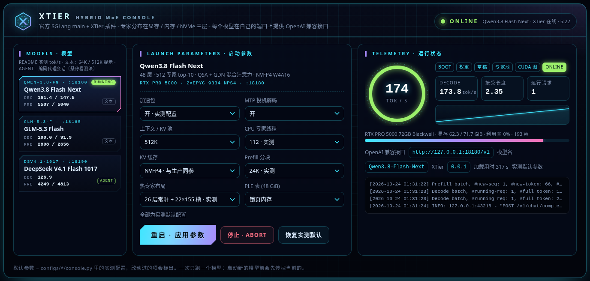

# XTier

[中文](../README.md) · [Quick start](quickstart.en.md)

This is the English version of the README. The other documents ([index](README.md)) are in Chinese, except the quick start.

**Cross-tier CPU/GPU hybrid MoE inference for [SGLang](https://github.com/sgl-project/sglang).** XTier is a plugin for upstream SGLang (tracking `main`): MoE experts live in GPU memory and host DRAM, are placed by how often they are used and computed where they are, while NVMe holds only the rows of large embedding tables (DeepSeek's Engram, Qwen's PLE). When host memory cannot hold all experts, an optional cold-expert pool keeps the rarely used ones on NVMe and reads them back when they are routed; its size and speed are bound by the drives' speed and type.

**Status: early development** ([plan](PLAN.md), in Chinese). Inkling-2-Small, Hunyuan-4-Flash NVFP4, Qwen3.8 Flash Next, GLM-5.3 Flash and DeepSeek V4.1 Flash 1017 run on SGLang main. MiniMax-M3.1-Flash runs on SGLang's M3.1 branch (PR #45925); its development is paused (too slow here, and not smart enough).

- **No changes to SGLang's source**: only the official plugin framework's hooks (on the entry of the official KTransformers hybrid inference), with a check after loading that the takeover worked.
- **Model-agnostic**: the hybrid backend wraps SGLang's standard `FusedMoE` quantization methods, so a model with the standard MoE layer can run without model-specific code (NVFP4 and MXFP4 experts).
- **Optional acceleration packs**: fixes and kernels specific to one model live in `xtier/packs/`.

## Layout

```
xtier/
├── backend/   hybrid MoE backend: takes over the official quantization methods, hands the weights to the CPU engine once loaded;
│              decode goes through a mailbox (capturable in CUDA graphs), prefill through grouped GEMMs on the GPU or the CPU
├── cache/     hot-expert cache: slots per layer can differ, fully resident layers skip the CPU; adaptive swapping; prefill of resident
│              layers on the slots; a second GPU as a hot-expert pool (optional, `XTIER_GPU2_SLOTS`);
│              cold-expert pool (optional, `XTIER_COLD=1`): rarely used experts on NVMe
├── planner/   planner: probed GPU / CPU costs + a routing profile -> hot-expert slots per layer within the memory budget
├── engine/    Python bindings of the CPU engine, CPU pinning, pinned memory (C++ sources in csrc/)
├── packs/     acceleration packs: qwen4_exp, glm5_next, deepseek_v4, minimax_m3, speculative
├── tables/    rows of large embedding tables on NVMe: multi-part files, any row width, a row cache, lookups inside CUDA graphs
├── console/   console: one web page to pick a model, set options, start / stop, follow loading and decode telemetry (standard library only)
└── platform.py  model-independent host fixes
csrc/          CPU engine: AVX-512 / AVX2 expert kernels, NUMA thread pool, CPU-GPU mailbox
configs/       start configurations per model and hardware; console.py is its entry in the console
tests/         single-layer tests, console and planner checks
tools/         build, memory guard, planner tools, repository checks
bench/         acceptance scripts (PPL, copy test, verify step, concurrency, prefill latency) and results
```

## Getting started

From an empty machine to the first request (environment, model preparation, start command, test request): [quick start](quickstart.en.md). With an SGLang environment already there:

```bash
git -C /path/to/sglang checkout 4ce41378f9      # the tested SGLang main (2026-11-21)
SGLANG_BUILD_RUST_EXTS=none pip install -e /path/to/sglang/python   # skips SGLang's optional Rust extensions if you have no Rust
tools/build_engine.sh /path/to/site-packages/nvidia/cu13   # CPU engine and mailbox -> xtier/engine/lib
pip install --no-deps -e .                      # registers the plugin entry sglang.srt.plugins: xtier
python tools/check_sglang.py --strict           # without a model: SGLang's commit, hook targets, imports, hooked code
XTIER=1 XTIER_THREADS=112 XTIER_MAIN_CPUS=auto XTIER_CACHE_SLOTS=155 \
  python -m sglang.launch_server --model-path <MoE checkpoint> --cuda-graph-backend-prefill disabled ...
```

XTier follows SGLang main and accepts one tested commit at a time ([xtier/\_\_init\_\_.py](../xtier/__init__.py), `SGLANG_COMMIT`). With another commit the server log warns, and `tools/check_sglang.py` lists the hooks that cannot apply (with `--strict` another commit fails too). Package versions: [constraints.txt](../constraints.txt). Settings: [xtier/config.py](../xtier/config.py). Full start arguments per model and hardware: [configs/](../configs/), or the console below.

Fast load (optional, `XTIER_FAST_LOAD=1`; off by default, SGLang's own loading): experts are read straight from the checkpoint files (with cold experts, from the cold store) into the CPU engine, all of them read and checked before the server reports online. DeepSeek V4.1 Flash 1017 starts in 186 s instead of 472 s. With MoE tensor parallelism (`--tp-size` > 1) each rank reads only its part.

## Console



From the repository root run `python3 -m xtier.console` (standard library only) and open http://127.0.0.1:8100/ :

- **Left, models**: a card per model with its port and measured speed.
- **Middle, options**: the defaults are the measured configuration; changed options are marked. Common ones: acceleration packs (off = the baseline of the speed tables), speculative decoding, context, CPU expert threads; the rest depend on the model (hot-expert slots, prefill chunks, elastic hot experts, cold experts, GPU help for missed experts).
- **Right, status**: loading stages (weights, draft, expert pool, CUDA graphs, warm-up, online), then decode speed, acceptance length, GPU memory and logs.

One model runs at a time; it serves an OpenAI-compatible API on its own port, and leaving the console does not stop it. To add a model, add a `console.py` under `configs/<model>-<hardware>/`.

The CPU expert threads take nearly every core and every MoE layer waits for all of them, so other busy processes slow decode down tenfold even at `nice 19` (Linux shares CPU time between control groups first). The console runs the server in a systemd scope of `CPUWeight=10000` (`--cpu-weight`); start CPU-heavy commands from a login session with `tools/low_cpu.sh COMMAND`. The server writes its log synchronously: keep `--log-dir` on a reliable disk.

## Supported models

| Model | Pack | Status |
|---|---|---|
| Inkling-2-Small (594B / 17B active, multimodal) | `inkling2` | Runs on SGLang main (512K KV / 2-conc, zero-patch 5-layer DSpark + lossless online truncation 0.20 + 23-layer ViT): default Plan A+ (`cold=2%`, 376/384 experts in RAM, 45 elastic hot slots, single-chunk 64K prefill `3,835 tok/s` = `2.41×`, `bs=1 74.7` / `bs=2 78.4 tok/s`, 512K NVFP4 KV `6.75 GiB` unlocking 500K) plus zero-cold Plan B2 (only `L47` full-GPU, 48K chunk `2,846 tok/s`); 13-seg PPL `ΔNLL +0.00423` / `KL 0.00938`, copy `0/8`, 256K/500K needles `5/5` |
| Hunyuan-4-Flash NVFP4 | `hy4_flash` | Runs on SGLang main (1M KV / 1M context / 4-conc, zero-patch 5-layer DFly2 + confidence truncation 0.20): hybrid SWA+DSA NVFP4 KV (`7.95 GB`), FP8 IndexPool, NVMe Engram, 208-layer FP8/W8A8; copy `0/4`, lossless PPL |
| Qwen3.8 Flash Next | `qwen4_exp` | Runs on SGLang main: accuracy, copy test and 512K recall as in production. Packs vs baseline: cold prefill 5% / 24% faster (64K / 512K). NVFP4 KV, with the saved GPU memory used for more resident layers, laid out by the planner by default. The PLE table (48 GiB) can stay on NVMe |
| GLM-5.3 Flash | `glm5_next` | Runs on SGLang main (with EAGLE). Packs (FP8 weights, hot-vocabulary rejection sampling, truncated verify, elastic hot experts) vs baseline: 22% faster per step on long replies, PPL 3.987 → 3.998 |
| DeepSeek V4.1 Flash 1017 | `deepseek_v4` | Runs on SGLang main (with DSpark). The rows of the Engram table (189 GB) stay on NVMe; copy test without errors. Packs (FP8 wo_a, paged indexer, elastic hot experts) vs baseline: 39% faster per step on long replies, 33% faster cold prefill |
| MiniMax-M3.1-Flash | `minimax_m3` | **Paused** (2026-10-26). Runs on SGLang's M3.1 branch (PR #45925) with DSpark; packs vs official code: 34% faster per step on long replies |

## Supported GPUs

What has really been run, per model, GPU and multi-GPU mode (whole model, first layers, single layer, emulated): [support table](support.md) (in Chinese).

| GPU | Status |
|---|---|
| Blackwell (SM120) | Development and benchmark platform (RTX PRO 5000 72 GB); also verified on an RTX PRO 6000 Blackwell 96 GB (Colab G4: Qwen3.8 whole model with MTP, 0/8 copy test, full model-free test suite) |
| Ada / RTX 40 series & L4 (SM89) | Supported. On an RTX 4090: Qwen3.8 whole model on 24 GB + 120 GB of host memory, copy test without errors, 120K context ([configuration](../configs/qwen38-rtx4090-3090/README.md)). GLM-5.3's first 8 layers and a DeepSeek V4.1 layer pass; their whole models were only emulated here. GLM needs speculative decoding off. Also verified on an NVIDIA L4 24 GB (Qwen3.8 whole model with 50% SSD cold offload + full model-free test suite) |
| Ampere / RTX 30 series (SM86) | Supported. On an RTX 3090: Qwen3.8 whole model on 24 GB, copy test without errors, 120K context, about 42 tok/s decode (a cloud host with 28 CPU threads). GLM-5.3's first 8 layers and a DeepSeek V4.1 layer pass; their whole models were only emulated here. FP8 is decoded in software (bit for bit as the hardware); GLM uses a BF16 KV and needs speculative decoding off |
| Ampere / A100 (SM80) | Supported. On an NVIDIA A100 40 GB: Qwen3.8 whole model (MTP=0 and MTP=1, 110 slots + NVMe PLE) passes copy test 0/8, plus the full model-free test suite. FP8 weights and KV are decoded in software (bit for bit as the hardware); first-start Marlin FP8 PTX JIT takes ~6–7 min and is cached afterwards |

## Two GPUs (tensor parallel)

With `TP=2` each GPU holds half of every hot expert and half of the KV cache, so each GPU fits over three times the hot-expert slots of one GPU. The CPU engine runs one process per rank on its GPU's NUMA nodes. No P2P or NVLink is needed: SGLang falls back to NCCL. Two RTX 3090s, Qwen3.8: decode 42.1 → 59.6–61.7 tok/s (+42–48%, 69–72 tok/s with MTP), first token at 120K 72.6 → 47.0 s, copy test without errors. See the [configuration](../configs/qwen38-rtx4090-3090/README.md#two-gpus-tp2).

With GPUs of different memory SGLang refuses to start; `SGLANG_ENABLE_TP_MEMORY_INBALANCE_CHECK=0` lets it run, but both GPUs then work with the smaller one's memory.

### A fast GPU with a slower one: the second GPU only holds hot experts

```
XTIER_GPU2_SLOTS=auto CUDA_VISIBLE_DEVICES=fast,slow bash configs/qwen38-rtx4090-3090/run-qwen.sh
```

- **How**: experts the main GPU misses and the second one holds are computed there, the results added to the CPU's through host memory, without P2P. Prefill uses only the main GPU.
- **Sizing**: `auto` keeps 1.5 GiB free and fills the rest with experts; the split of the work adapts by itself.
- **Accuracy**: on Qwen, GLM and DeepSeek single layers, results are bit for bit those of the main GPU.
- **Limits**: `TP=1` only, not together with cold experts; if the main GPU has hardware FP4 decode, the second one needs it too.

**All of this was emulated on two RTX 4090s** (Qwen3.8, single requests, 512 tokens); real mixed GPUs have not been tested, and DeepSeek and GLM only as single layers and first layers.

| Configuration | Hot slots per layer | 32K decode tok/s | 120K decode tok/s | 120K first token |
|---|---|---:|---:|---:|
| One GPU, 24 GiB (reference) | 48 | 41.0 (100%) | 43.6 (100%) | 60.9 s (100%) |
| Same GPUs, TP, 24 + 24 GiB | 180 (half experts) | 62.1 (151%) | 63.4 (145%) | 68.9 s (88%) |
| Mixed memory, TP, 24 + 16 GiB | 64 (half experts) | 51.1 (125%) | 49.4 (113%) | 60.0 s (101%) |
| Same GPUs, hot pool, main 24 + pool 24 GiB | 48 + 178 | 58.2 (142%) | 56.2 (129%) | 59.3 s (103%) |
| **Mixed memory, hot pool, main 24 + pool 16 GiB** | **48 + 113** | **57.3 (140%)** | **55.9 (128%)** | **58.9 s (103%)** |
| Same, the pool GPU taking about 1.2 times as long | 48 + 113 | 54.5 (133%) | 54.2 (124%) | 59.0 s (103%) |

## Speed

One RTX PRO 5000 72GB, 2× EPYC 9334 (NPS4), 384 GiB DDR5, in tok/s, the latest measurement only. **The three DeepSeek packs rows were measured again on 2026-11-24 on SGLang main 4ce41378f9 (24-token weight-reuse decode, fused writeback, 43-layer FP8 wo_a, zero-sync DMA FP4 prefill with intermediate-chunk tail skip, cross-chunk Engram lookahead, context Recall on DSpark, four running requests); the other rows when XTier tracked SGLang main 8cd3c494 (late October 2026).** Later versions did not measure them again; each version checks 64K / 512K speed, accuracy and end-to-end agent tasks across all three models.

[bench/agent_bench.py](../bench/agent_bench.py) imitates a coding agent: 5 sessions from 64K to about 500K tokens fill a 512K KV pool, with several tool-calling steps each, two rounds in one server start. Cold prefill = the tokens of a session's first request missing the cache / its first-token time. Decode counts long replies only (≥ 300 tokens). **Baseline = the console's packs off: SGLang main plus XTier's hybrid backend and the fixes needed to run, without speedups. It is not plain SGLang.**

### Inkling-2-Small (594B / 17B active, multimodal)

RTX PRO 5000 72 GB · 512K context / 2 concurrent requests (40 NVFP4 + 8 MXFP8 MoE, 40 SWA + 8 global attention, 23-layer ViT, native 5-layer DSpark):

| Mode | Boot | Decode bs=1 | Decode bs=2 agg | 64K cold prefill | 64K cached decode | 256K cold prefill | 500K cold prefill | 500K cached decode |
|---|---:|---:|---:|---:|---:|---:|---:|---:|
| **XTier + packs (Plan A+ default: `cold=2%`, 45 slots, 64K)** | **126 s** | **74.7** (r0 81.7) | **78.4** | **3,835** (17.1 s) | **52.6** (peak **66.7**, 42.0 ms) | **2,464** (106.4 s) | **1,593** (313.9 s) | **43.7** (peak 47.0, 53.8 ms) |
| XTier + packs (Plan A safe: `cold=8%`, 44 slots, 64K) | 120 s | 71.1 (peak 77.2) | 79.0–83.3 | 3,815 (17.2 s) | 58.5 (peak 63.5, 45.1 ms) | 2,465 (106.3 s) | 1,603 (311.8 s) | **47.0** (peak 51.1, 53.7 ms) |
| XTier + packs (Plan B2 zero-cold: `L47` full-GPU, 35 slots, 48K) | 420 s | 82.9 (r0) | 72.6 | 2,846 (23.1 s) | 56.8 (peak 62.5, 40.1 ms) | 2,215 (118.3 s) | 1,512 (330.7 s) | 40.1 (peak 47.4, 56.6 ms) |
| **Baseline (packs off: `W4A16/W8A16, BF16 KV, 16K, 27 slots`)** | ~390 s | 47.9 | ~43 | 1,591 (41.3 s) | 43.4 (82.3 ms) | 1,217 (215.3 s) | OOM | OOM |

Packs vs baseline: `2.41×` / `2.02×` faster 64K / 256K cold prefill, `+56%` / `+82%` faster `bs=1` / `bs=2` decode, and 512K Target NVFP4 KV (`6.75 GiB`, `3.56×` smaller) with a far-tile unmasked decode kernel unlocks 500K context. Full 2-round `agent_bench` (64K→513K, 91/91 cached): **`66.2 tok/s`** on long replies (`66.3 tok/s` overall, acceptance `4.02`, `60.6 ms/step`). Default Plan A+ keeps 376/384 (97.9%) experts in RAM (`12–15 GiB` available RAM, `0.2–0.7` cold decode reads/step, `70.65 / 73.4 GiB` VRAM, 0 OOM retries); `cold=off` switches to Plan B2 (`L47` full-GPU zero-RAM). Accuracy: 13-segment PPL `ΔNLL +0.00423`, `KL 0.00938`, copy test `0/8`, 256K & 500K 5-depth needles `5/5`, reasoning/tool-calling/vision all verified.

### DeepSeek V4.1 Flash 1017

| DSpark | Round | Cold prefill, 64K session | Cold prefill, 500K session | Decode (long replies) | Acceptance | Per step |
|---|:-:|---:|---:|---:|---:|---:|
| XTier + packs | 1 | 5,969 | 9,038 | 156.6 | 4.64 | 29.6 ms |
|  | 2 | 7,967 | 9,023 | 154.7 | 4.65 | 30.1 ms |
| XTier + packs, 4 requests at a time (in all) | — | — | — | 268 | 3.40 | 51.0 ms |
| Baseline (packs off) | 1 | 3,318 | 3,627 | 65.5 | 3.25 | 50.9 ms |

Packs vs baseline: 155.4 vs 65.5 tok/s on long replies across both rounds (29.9 vs 50.9 ms per step, 41% faster; 157.8–162.2 tok/s at 28.8 ms/step on matched 64K / 128K sessions, while round 2's 384K session grew to 488K KV context writing long files, raising token-weighted long-reply context to 234K / 282K), cold prefill of the 64K / 500K sessions 110% / 149% faster (mean 6,968 / 9,030 tok/s, with both 500K rounds past 9,000 tok/s; 128K / 256K / 384K sessions reach 8,449–8,714 / 8,844–8,931 / 8,927–8,966 tok/s and steady 48K chunks reach 9,806–9,999 tok/s); across all 127 requests of the two rounds (tool calls included) decode averages 163.9 tok/s, acceptance 4.74, 28.9 ms per step, with 500–900-token tool-turn TTFT around 1.1 s; 100% lossless (13-segment PPL NLL 1.2001 vs baseline 1.1996), copied text without errors (now and then a `</src>` follows a segment, as before). The third row: four prompts of about 16K tokens writing 3,000 fresh tokens each at a time; decode is the four requests together (62–69 tok/s each; 332–382 tok/s in all when rewriting or editing existing files), accept length and step are theirs; two fresh requests at a time make 195.8 tok/s in all (37.4 ms/step), a single request 26.6–28.2 ms per step.

**Lossless 24-token weight-reuse decode, fused writeback, 43-layer FP8 `wo_a`, fast eager MXFP8 dispatch, and intermediate-chunk tail skip: both 500K cold prefill rounds >9,000 tok/s, 4-way decode up to 268 tok/s, and 160K cold prefill +14.4% faster (2026-11-24).** With zero SGLang source patches and 100% lossless numerics: (1) decode slots expand to `SLOT_TOKENS=24` (`SLOT_ROUTES=144`, `DECODE_M=24`) with weight-reuse `_gate_up_2x16` / `_down_2x16` tiles for `17..24` rows (eliminating `16+2` / `16+8` splits at `bs=3/4` for +35 MiB shared scratch while keeping all `+26` elastic hot slots = 61 active slots), cutting steady 61-slot `M=18` steps from `57.5` to `45.0 ms` (−21.8%) and `M=24` from `80.0` to `71.4 ms` (−10.8%); (2) `_down` moves to `dbn=128` with `TOK_MASK` sparse reads/stores, `_commit` runs 256-way parallel swaps, fully resident layers use a single-CTA `_pack`, `_combine`/`_unpack` fuse `BF16` cast and scaling (removing 83 elementwise launches/step), and `wo_a` covers all 40 target + 3 draft = 43 layers in lossless FP8, lifting single-stream `recall` to `212.0–212.5 tok/s` (`28.2 ms`/step) and back-to-back `bs=1` reasoning from `26.82` to `26.60 ms`/step; (3) SM120 eager `_mxfp8_linear` calls `mxfp8_quantize_sm100` directly with cached `b12x` compiled kernels (`121 → 10 µs` dispatch, `b12x/cutlass` threshold raised to `768`), `shared_experts` reuses MoE pre-quantized activations, 48K chunks merge 5-band `_reduce_band` into 1 band when free VRAM permits, `hybrid_prefill` stages CPU inputs on a dedicated D2H stream before GPU `argsort/bincount`, and non-final chunks skip `L21..39` after `L20` writes its compressed source KV: 160K cold prefill drops from `20.43 s` (`7,833 tok/s`) to **`17.86 s` (`8,961 tok/s`, +14.4%)**, first 16.5K prefill `4.22 → 3.81 s` (−9.7%), and `286–594`-token incremental prefill `−2% ~ −5%`; 1/2/4-way copy tests (`0/8`), 160K 3-needle recall, and 13-segment PPL (`1.2001`) all pass.

**Keeping the default 48K chunk size, cold prefill reaches 8,894–9,085 tok/s at 384K–500K and 7,713 tok/s in round-2 64K, while tool turns run 1.86× faster (2026-11-19).** Building on 48K chunking and cross-chunk Engram lookahead ([v0.1.7 report](reports/2026-11-18-lossless-prefill-recall.md), in Chinese) without changing chunk size or precision: (1) core `_run_fp4` pre-swizzles `UE8M0` weight scales in pinned host memory so `_copy_stream` runs pure DMA across 24 staging slots, replacing `torch.unique`, `torch.bincount` (200 implicit stream syncs per chunk), and multi-pass scatter with a 1-sync L2 bitmap, zero-sync band histograms, order-preserving single-pass `_reduce_band`, and full-duplex `_d2h_stream` `CPU_SHARE` overlap; (2) core `engine.cpp` enables dynamic guided work-stealing and per-thread L2 buffers above 16 rows, which together with a 640-token hybrid threshold and 7.5× parallel BPE tokenization cuts 743-token tool-turn TTFT from 2.07 s to 1.12 s; (3) on SM120, the DeepSeek pack adds bitwise-exact PTX `mhc.post` (60.1 → 4.4 ms, eliminating a +22.5 GiB broadcast spike at 48K rows), enables 24-bit `bf16x3` mHC projections, autotunes `>=512`-row CUTLASS MXFP8 prefill projections, adds an L2-grouped BF16 `wo_a` prefill kernel, and skips redundant intermediate-chunk SWA boundary replays. [Report](reports/2026-11-19-lossless-9k-prefill.md) (in Chinese).

**A long-reply decode step drops to 28.8 ms; context Recall lifts all requests to 180.4 tok/s and 4-way file rewrite/editing to 332–382 tok/s (2026-11-18).** Extending the small-batch fast kernel (`b12x`) to 1–32 rows, grouped `wo_a` projections to 64 rows, and single-row `markov_w2` drafts to Tensor Cores brings a long-reply step down to 28.8 ms ([step profile](reports/2026-11-11-decode-step.md), in Chinese). The console also enables context Recall (`XTIER_RECALL=1`) by default: a rolling hash in host RAM indexes the session's context and recent replies, filling draft slots whenever the model begins emitting a path, identifier or code block already in context; the main model verifies every token (100% lossless, 0 extra GPU kernels when unmatched). The table's long replies (153.5–154.0 tok/s) and row 3's four-way fresh generation (258 tok/s) write new text from scratch and rarely trigger Recall; tool calls in `agent_bench` quote paths and snippets from context, reaching 233–258 tok/s per session and lifting all 159 requests to 180.4 tok/s (26.5 ms/step); and when four concurrent requests rewrite or edit existing files, drafts match existing spans across streams to reach 332 tok/s (mixed rewrite and editing) to 382 tok/s (multi-turn localized edits), i.e. 332–382 tok/s. [Report](reports/2026-11-18-lossless-prefill-recall.md) (in Chinese).

### Qwen3.8 Flash Next

| MTP | Round | Cold prefill, 64K session | Cold prefill, 500K session | Decode (long replies) | Acceptance | Per step |
|---|:-:|---:|---:|---:|---:|---:|
| XTier + packs | 1 | 5,715 | 5,170 | 181.7 | 2.57 | 14.2 ms |
|  | 2 | 5,610 | 5,150 | 207.2 | 2.68 | 13.0 ms |
| Baseline (packs off) | 1 | 5,319 | 4,078 | 139.5 | 2.13 | 15.2 ms |

Packs (planner layout) vs baseline: 13.6 vs 15.2 ms per step (11% faster), cold prefill 6% / 27% faster at 64K / 500K; a slight accuracy loss (NVFP4 KV, as in production), PPL 3.481, copy test without errors.

### GLM-5.3 Flash

| EAGLE | Round | Cold prefill, 64K session | Cold prefill, 500K session | Decode (long replies) | Acceptance | Per step |
|---|:-:|---:|---:|---:|---:|---:|
| XTier + packs | 1 | 2,648 | 2,640 | 96.3 | 2.54 | 26.4 ms |
|  | 2 | 2,715 | 2,635 | 98.2 | 2.66 | 27.1 ms |
| Baseline (packs off) | 1 | 2,663 | 2,518 | 76.8 | 2.61 | 34.4 ms |

Packs (58 slots + elastic hot experts) vs baseline: 26.9 vs 34.4 ms per step (22% faster), cold prefill 1% / 5% faster at 64K / 500K; a slight accuracy loss (attention and dense layers in FP8, PPL 3.987 → 3.998), copy test without errors.

### MiniMax-M3.1-Flash (paused)

| DSpark | Round | Cold prefill, 64K session | Decode (long replies) | Acceptance | Per step |
|---|:-:|---:|---:|---:|---:|
| XTier + packs | 1 | 1,854 | 53.4 | 3.04 | 56.9 ms |
|  | 2 | 1,877 | 50.0 | 2.70 | 54.0 ms |
| Official code + needed fixes | 1 | 1,824 | 46.8 | 3.94 | 84.3 ms |
|  | 2 | 1,883 | 45.5 | 3.82 | 84.0 ms |

SGLang's M3.1 branch (PR #45925), fixed 512K, 64K session only; packs vs official code + needed fixes: 55.4 vs 84.1 ms per step (34% faster).

## Cold experts on NVMe

When host memory cannot hold all experts, each layer keeps only part of them in RAM; the others sit in a cold pool on NVMe and are read back when routed (`XTIER_COLD=1`, off by default, [design](design-cold-experts.md)). A miss reads from all drives at once, so the speed depends mostly on the drives. The console's DeepSeek card offers 10% / 20% / 30% cold.

All four models passed an end-to-end regression at 30% cold (no copy-test errors, no failures in a 15-minute dsh session; on four PCIe 4.0 drives then):

| Model | Experts in RAM per layer | Host memory (none → 30% cold) |
|---|---|---:|
| DeepSeek V4.1 Flash 1017 | 269 / 384 | 298 → 224 GiB |
| GLM-5.3 Flash | 202 / 288 | 174 → 129 GiB |
| Qwen3.8 Flash Next | 358 / 512 (only the 18 layers on the CPU) | 121 → 116 GiB |
| MiniMax-M3.1-Flash | 90 / 128 | 227 → 165 GiB |

### DeepSeek V4.1 Flash 1017: share on disk and speed

Four PCIe 5.0 drives (Samsung 9100 PRO, 50.6 GB/s reading all four), agent_bench's 64K session, single runs (±5–10%):

| Cold | On disk | Decode per step / tok/s | 64K cold prefill (tok/s) |
|---|---:|---|---|
| None | 0 | 30.0 ms / 142 | 4,300 |
| 10% | 27 GiB | 31.6 ms / 135 (−5%) | 3,784 (−12%) |
| 20% | 54 GiB | 34.4 ms / 124 (−13%) | 3,742 (−13%) |
| 30% | 81 GiB | 37.9 ms / 112 (−21%) | 3,731 (−13%) |
| 40% | 108 GiB | 44.5 ms / 96 (−32%) | 3,672 (−15%) |
| 50% | 134 GiB | 53.5 ms / 80 (−44%) | 3,537 (−18%) |

Test the drives with several minutes of sustained reads: a DRAM-less drive (HP FX700) fell to about 60 MB/s after about 100 s at full speed and held up the whole pool. Details: [report](reports/2026-11-01-cold-pcie5.md) (in Chinese).

### One copy of a big model

The store holds every expert, so `tools/cold_punch.py` compares every byte and then punches the experts out of the checkpoint files (`--restore` writes them back): DeepSeek V4.1 Flash 1017 290 → 21 GiB. The cost: the store is then the only copy, a lost drive means downloading the model again, and SGLang without XTier cannot load the directory.

### Options (off by default)

- **Drives other than four or of unequal speed**: `XTIER_COLD_UNITS=3` spreads each record by drive speed (e.g. `XTIER_COLD_PARTS=5:5:5:5:2:2`); `tools/cold_relayout.py` moves an existing store. [Report](reports/2026-11-06-cold-units-tail-skip.md) (in Chinese)
- **Route tail skip** (changes the output): with `XTIER_TAIL_SKIP=5/6` (keep/total), a decode step skips an expert the CPU computes if no token has it among its 5 largest routes. DeepSeek without cold experts: a step only 2.3% faster; it pays off when most experts are on drives. [Report](reports/2026-11-06-tail-skip-cpu.md) (in Chinese)

### Minimal run: DeepSeek V4.1 Flash 1017 on 32 GB of GPU memory + 128 GB of host memory

An emulation of one RTX 5090: 32 GB of GPU memory and 128 GB of host memory as hard limits, 70% cold, the store on four PCIe 4.0 drives (console card "DeepSeek V4.1 Flash 1017 · 最小化"). About 25% of the normal speed, bound by the drives; [report](reports/2026-10-27-ds41-minimal.md) (in Chinese).

| tok/s | 32K | 64K | 128K |
|---|---:|---:|---:|
| Prefill (32 GB + 128 GB) | 1,186 | 1,165 | 1,155 |
| Decode (32 GB + 128 GB) | 28.5 | 28.1 | 32.7 |
| Prefill (normal) | 3,886 | 4,609 | 4,655 |
| Decode (normal) | 130.7 | 127.9 | 122.4 |

## Latest changes

All changes: [changelog](changelog.md) (in Chinese).

- 2026-11-25 (v0.1.10): adds full zero-patch support and console card for **Thinking Machines Inkling-2-Small (594B / 17B active, multimodal)** alongside the 11-24 DeepSeek V4.1 lossless 9K+ optimizations. Highlights: CPU engine/mailbox MXFP8 + SiTU (4.0/25.0) support and zero-RAM full-GPU layer placement; NVFP4 `W4A4 4over6 MAE` + MXFP8 cuDNN prefill, 116-layer FP8/W8A8 (`tl.int64` indexing fix), and 3-stream sliced Global Attention projections (`2.6×` less FLOPs, `-3.3 GiB` VRAM); 48-layer Target NVFP4 KV (`6.75 GiB` at 512K) + far-tile unmasked decode kernel (`14.70 → 11.31 ms` at 500K) + FA4 `_shear_bias_workspace` reclamation; zero-patch `_mix_norm` chunking fixing upstream Triton `int32` overflow to unlock **64K single-chunk prefill (`3,835 tok/s`, `2.41×` vs baseline)**; lossless DSpark `OnlineAcceptanceEstimator` truncation (`0.20`) + Recall; `_copy_stream` DMA UAF fix & `cold.relink()` ascending layer-order prefetch (`0.0 s` NVMe wait); per-model console `guard_gib` with default **Plan A+** (`cold=2%`, 45 hot slots, `12–15 GiB` avail RAM, `guard_gib=8`) and zero-cold **Plan B2** (`L47` full-GPU, 48K chunk, 35 slots). 13-seg PPL `ΔNLL +0.00423` / `KL 0.00938`, copy `0/8`, 256K/500K needles `5/5`, 2-round `agent_bench` `66.3 tok/s` (accept `4.02`).
- 2026-11-24: lossless DeepSeek V4.1 Flash 1017 and core decode/prefill optimizations (`SLOT_TOKENS=24` weight-reuse `2x16` decode kernels keeping all `+26` elastic slots, `dbn=128 + TOK_MASK`, 256-way `_commit`, fused `BF16`+scale writeback, 40+3=43-layer FP8 `wo_a`, SM120 fast eager MXFP8 dispatch + `shared_experts` pre-quant reuse, 1-band `_reduce_band`, async `hybrid_prefill` D2H wakeup, and intermediate-chunk `L21..39` tail skip after `L20` source-KV write): `agent_bench` cold prefill rises to `5,969 / 7,967` at 64K and `9,038 / 9,023 tok/s` at 500K (both rounds >9,000), 4-way concurrent fresh decode reaches `268 tok/s` (`51.0 ms`/step, 2-way `195.8 tok/s` at `37.4 ms`/step), 160K cold prefill `20.43 → 17.86 s` (`7,833 → 8,961 tok/s`, +14.4%), `M=18/24` verify steps 11–22% faster, incremental prefill 2–5% faster; TSan/ASan, bitwise kernel checks, 1/2/4-way copy (`0/8`), 160K 3-needle recall, and 13-segment PPL all passed.
- 2026-11-22 (v0.1.8): follows SGLang main `4ce41378f9` (672 commits after `084a5e9aae`) and releases the 11-19 **9,000+ lossless prefill / 1.1 s tool-turn** pipeline together with **default CPU multimodal image/video decoding and bounded CPU worker pools** (`XTIER_CPU_IMAGE=1`, `XTIER_MM_CPU_WORKERS`: 0 MiB VRAM in the API/tokenizer process, avoiding 128-process fork contention against MoE cores). Dependencies: `sglang-kernel 0.4.11`, `sgl-deep-gemm 0.2.9`, `sgl-fa3 0.1.0`, `tml-renderers 0.4.2` (torch 2.14.1+cu130 and FlashInfer 0.7.4 unchanged). Drops now-upstreamed SM120 DSv4.1 indexer and EAGLE hot-vocab rejection-sampling workarounds (unlocking upstream `use_fused_draft_sample`, speeding up GLM-5.3 decode by ~1–1.5 ms/step). Full three-model regression (including 4-way high-res JPEG CPU decoding, static verify, sequence wraparound, and SM86 emulation) passed. [Report](reports/2026-11-22-sglang-4ce4137.md) (in Chinese)
- 2026-11-19: 100% lossless prefill past 9,000 tok/s and 1.86× faster tool turns without changing the 48K default chunk size. Core (all models): `_run_fp4` pre-swizzled `UE8M0` scales, 24 pure-DMA staging slots, 1-sync L2 bitmap + zero-sync band histograms, order-preserving single-pass `_reduce_band`, and full-duplex `CPU_SHARE`; `engine.cpp` dynamic guided stealing + per-thread L2 buffers above 16 rows; persistent `hybrid_prefill` pinned buffers; 7.5× parallel BPE tokenization; `elastic.py` 2,048-token staging regime guard. DeepSeek pack: SM120 bitwise-exact PTX `mhc.post` (eliminating a +22.5 GiB broadcast spike), 24-bit `bf16x3` mHC projections, `>=512`-row CUTLASS MXFP8 prefill autotuning, L2-grouped BF16 `wo_a` prefill kernel, intermediate-chunk SWA replay pruning, and 640-token hybrid threshold. DeepSeek V4.1 `agent_bench` cold prefill rises to 5,719 / 7,713 at 64K and 8,950 / 8,930 tok/s at 500K (384K–500K reaches 8,894–9,085 tok/s, 458K cold prompt 9,180 tok/s), long replies 159.0 tok/s, 743-token tool TTFT 2.07 → 1.12 s; 58 unit tests, TSan/ASan, PPL, wraparound and model regressions passed. [Report](reports/2026-11-19-lossless-9k-prefill.md) (in Chinese)
- 2026-11-18 (v0.1.7): lossless prefill fusion, cross-chunk Engram lookahead, and context Recall on DSpark (on by default in the console, verified token-by-token by the main model). DeepSeek V4.1 cold prefill rises to 5,568 / 7,158 at 64K and 7,677 / 7,590 tok/s at 500K; agent_bench long replies reach 153.5–154.0 tok/s at 28.8 ms/step (180.4 tok/s at 26.5 ms/step across all requests including tool calls); 4 concurrent requests make 258 tok/s writing from scratch (332–382 tok/s when rewriting or editing existing files). Core layers also speed up 1K–6K FP4 prefill, LBA-deduplicated NVMe row-table prefetching, and elastic-cache regime bounds; full regression, PPL and 15-minute dsh sessions passed on all three models with 0 errors. [Report](reports/2026-11-18-lossless-prefill-recall.md) (in Chinese)
- 2026-11-14 (v0.1.6): follows SGLang main 084a5e9 (592 commits after 27bc1a0); no change to XTier's runtime code. Dependencies: FlashInfer 0.7.4, nvidia-cudnn-frontend 1.32.3, sgl-deep-gemm 0.2.8, sgl-flash-mla 1.0.5. The 17 hooked functions whose source changed were read one by one; the hook fingerprints are updated. The regression of the three models passed: decode as before; DeepSeek's cold prefill about 10% faster (64K 6,144–6,691, 520K 6,761 tok/s; upstream changed the DSv4 prefill blocking), GLM and Qwen as before. `tools/arch_check.py`'s emulation follows a change in SGLang's JIT toolchain. The first start after the FlashInfer update compiles its kernels and takes a few minutes longer. [Report](reports/2026-11-14-sglang-084a5e9.md) (in Chinese)
- 2026-11-12 (v0.1.5): DeepSeek V4.1 runs 4 requests at a time (2 before): four at a time make 254 tok/s in all (two made about 175 tok/s before), two 191 tok/s, and one request is as fast as before. Its KV pool holds 1M tokens (a request's context limit stays 512K), so what an agent's sub-agents read no longer pushes the main session's cache out. An expert call holds up to 16 tokens instead of 8 (all three models), so the verify rows of several requests are computed together; the console's DSpark verification defaults to variable-length, its cost table covers 4 requests. About 1.2 GiB more GPU memory. The regression of the three models passed. [Report](reports/2026-11-12-ds-four-requests.md) (in Chinese)

## License

Apache-2.0, see [LICENSE](../LICENSE) and [NOTICE](../NOTICE).
