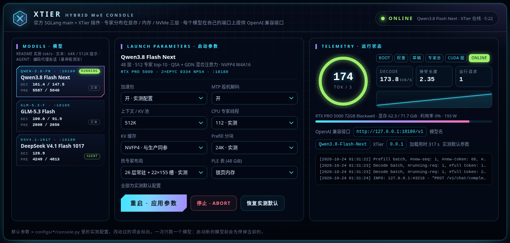

# XTier

[中文](../README.md) · [Quick start](quickstart.en.md)

This is the English version of the README. The other documents ([index](README.md)) are in Chinese, except the quick start.

**Cross-tier CPU/GPU hybrid MoE inference for [SGLang](https://github.com/sgl-project/sglang).** XTier is a plugin for upstream SGLang (tracking `main`): MoE experts live in GPU memory and host DRAM, are placed by how often they are used and computed where they are, while NVMe holds only the rows of large embedding tables (DeepSeek's Engram, Qwen's PLE). When host memory cannot hold all experts, an optional cold-expert pool keeps the rarely used ones on NVMe and reads them back when they are routed; its size and speed are bound by the drives' speed and type.

**Status: early development** ([plan](PLAN.md), in Chinese). Qwen3.8 Flash Next, GLM-5.3 Flash and DeepSeek V4.1 Flash 1017 run on SGLang main. MiniMax-M3.1-Flash runs on SGLang's M3.1 branch (PR #45925); its development is paused (too slow here, and not smart enough).

- **No changes to SGLang's source**: only the official plugin framework's hooks (on the entry of the official KTransformers hybrid inference), with a check after loading that the takeover worked.
- **Model-agnostic**: the hybrid backend wraps SGLang's standard `FusedMoE` quantization methods, so a model with the standard MoE layer can run without model-specific code (NVFP4 and MXFP4 experts).
- **Optional acceleration packs**: fixes and kernels specific to one model live in `xtier/packs/`.

## Layout

```
xtier/
├── backend/   hybrid MoE backend: takes over the official quantization methods, hands the weights to the CPU engine once loaded;
│              decode goes through a mailbox (capturable in CUDA graphs), prefill through grouped GEMMs on the GPU or the CPU
├── cache/     hot-expert cache: slots per layer can differ, fully resident layers skip the CPU; adaptive swapping; prefill of resident
│              layers on the slots; a second GPU as a hot-expert pool (optional, `XTIER_GPU2_SLOTS`);
│              cold-expert pool (optional, `XTIER_COLD=1`): rarely used experts on NVMe
├── planner/   planner: probed GPU / CPU costs + a routing profile -> hot-expert slots per layer within the memory budget
├── engine/    Python bindings of the CPU engine, CPU pinning, pinned memory (C++ sources in csrc/)
├── packs/     acceleration packs: qwen4_exp, glm5_next, deepseek_v4, minimax_m3, speculative
├── tables/    rows of large embedding tables on NVMe: multi-part files, any row width, a row cache, lookups inside CUDA graphs
├── console/   console: one web page to pick a model, set options, start / stop, follow loading and decode telemetry (standard library only)
└── platform.py  model-independent host fixes
csrc/          CPU engine: AVX-512 / AVX2 expert kernels, NUMA thread pool, CPU-GPU mailbox
configs/       start configurations per model and hardware; console.py is its entry in the console
tests/         single-layer tests, console and planner checks
tools/         build, memory guard, planner tools, repository checks
bench/         acceptance scripts (PPL, copy test, verify step, concurrency, prefill latency) and results
```

## Getting started

From an empty machine to the first request (environment, model preparation, start command, test request): [quick start](quickstart.en.md). With an SGLang environment already there:

```bash
git -C /path/to/sglang checkout 6162b07199      # the tested SGLang main (2026-10-30)
SGLANG_BUILD_RUST_EXTS=none pip install -e /path/to/sglang/python   # skips SGLang's optional Rust extensions if you have no Rust
tools/build_engine.sh /path/to/site-packages/nvidia/cu13   # CPU engine and mailbox -> xtier/engine/lib
pip install --no-deps -e .                      # registers the plugin entry sglang.srt.plugins: xtier
python tools/check_sglang.py --strict           # without a model: SGLang's commit, XTier's hook targets and imports
XTIER=1 XTIER_THREADS=112 XTIER_MAIN_CPUS=auto XTIER_CACHE_SLOTS=155 \
  python -m sglang.launch_server --model-path <MoE checkpoint> --cuda-graph-backend-prefill disabled ...
```

XTier follows SGLang main and accepts one tested commit at a time ([xtier/\_\_init\_\_.py](../xtier/__init__.py), `SGLANG_COMMIT`). With another commit the server log warns, and `tools/check_sglang.py` lists the hooks that cannot apply (with `--strict` another commit fails too). Package versions: [constraints.txt](../constraints.txt). Settings: [xtier/config.py](../xtier/config.py). Full start arguments per model and hardware: [configs/](../configs/), or the console below.

Fast load (optional, `XTIER_FAST_LOAD=1`; off by default, SGLang's own loading): experts are read straight from the checkpoint files (with cold experts, from the cold store) into the CPU engine, all of them read and checked before the server reports online. DeepSeek V4.1 Flash 1017 starts in 186 s instead of 472 s. With MoE tensor parallelism (`--tp-size` > 1) each rank reads only its part.

## Console



From the repository root run `python3 -m xtier.console` (standard library only) and open http://127.0.0.1:8100/ :

- **Left, models**: a card per model with its port and measured speed.
- **Middle, options**: the defaults are the measured configuration; changed options are marked. Common ones: acceleration packs (off = the baseline of the speed tables), speculative decoding, context, CPU expert threads; the rest depend on the model (hot-expert slots, prefill chunks, elastic hot experts, cold experts, GPU help for missed experts).
- **Right, status**: loading stages (weights, draft, expert pool, CUDA graphs, warm-up, online), then decode speed, acceptance length, GPU memory and logs.

One model runs at a time; it serves an OpenAI-compatible API on its own port, and leaving the console does not stop it. To add a model, add a `console.py` under `configs/<model>-<hardware>/`.

## Supported models

| Model | Pack | Status |
|---|---|---|
| Qwen3.8 Flash Next | `qwen4_exp` | Runs on SGLang main: accuracy, copy test and 512K recall as in production. Packs vs baseline: cold prefill 5% / 24% faster (64K / 512K). NVFP4 KV, with the saved GPU memory used for more resident layers, laid out by the planner by default. The PLE table (48 GiB) can stay on NVMe |
| GLM-5.3 Flash | `glm5_next` | Runs on SGLang main (with EAGLE). Packs (FP8 weights, hot-vocabulary rejection sampling, truncated verify, elastic hot experts) vs baseline: 22% faster per step on long replies, PPL 3.987 → 3.998 |
| DeepSeek V4.1 Flash 1017 | `deepseek_v4` | Runs on SGLang main (with DSpark). The rows of the Engram table (189 GB) stay on NVMe; copy test without errors. Packs (FP8 wo_a, paged indexer, elastic hot experts) vs baseline: 39% faster per step on long replies, 33% faster cold prefill |
| MiniMax-M3.1-Flash | `minimax_m3` | **Paused** (2026-10-26). Runs on SGLang's M3.1 branch (PR #45925) with DSpark; packs vs official code: 34% faster per step on long replies |

## Supported GPUs

What has really been run, per model, GPU and multi-GPU mode (whole model, first layers, single layer, emulated): [support table](support.md) (in Chinese).

| GPU | Status |
|---|---|
| Blackwell (SM120) | Development and benchmark platform (RTX PRO 5000) |
| RTX 40 series (SM89) | Supported. On an RTX 4090: Qwen3.8 whole model on 24 GB + 120 GB of host memory, copy test without errors, 120K context ([configuration](../configs/qwen38-rtx4090-3090/README.md)). GLM-5.3's first 8 layers and a DeepSeek V4.1 layer pass; their whole models were only emulated here. GLM needs speculative decoding off |
| RTX 30 series (SM86) | Supported. On an RTX 3090: Qwen3.8 whole model on 24 GB, copy test without errors, 120K context, about 42 tok/s decode (a cloud host with 28 CPU threads). GLM-5.3's first 8 layers and a DeepSeek V4.1 layer pass; their whole models were only emulated here. FP8 is decoded in software (bit for bit as the hardware); GLM uses a BF16 KV and needs speculative decoding off |

## Two GPUs (tensor parallel)

With `TP=2` each GPU holds half of every hot expert and half of the KV cache, so each GPU fits over three times the hot-expert slots of one GPU. The CPU engine runs one process per rank on its GPU's NUMA nodes. No P2P or NVLink is needed: SGLang falls back to NCCL. Two RTX 3090s, Qwen3.8: decode 42.1 → 59.6–61.7 tok/s (+42–48%, 69–72 tok/s with MTP), first token at 120K 72.6 → 47.0 s, copy test without errors. See the [configuration](../configs/qwen38-rtx4090-3090/README.md#two-gpus-tp2).

With GPUs of different memory SGLang refuses to start; `SGLANG_ENABLE_TP_MEMORY_INBALANCE_CHECK=0` lets it run, but both GPUs then work with the smaller one's memory.

### A fast GPU with a slower one: the second GPU only holds hot experts

```
XTIER_GPU2_SLOTS=auto CUDA_VISIBLE_DEVICES=fast,slow bash configs/qwen38-rtx4090-3090/run-qwen.sh
```

- **How**: experts the main GPU misses and the second one holds are computed there, the results added to the CPU's through host memory, without P2P. Prefill uses only the main GPU.
- **Sizing**: `auto` keeps 1.5 GiB free and fills the rest with experts; the split of the work adapts by itself.
- **Accuracy**: on Qwen, GLM and DeepSeek single layers, results are bit for bit those of the main GPU.
- **Limits**: `TP=1` only, not together with cold experts; if the main GPU has hardware FP4 decode, the second one needs it too.

**All of this was emulated on two RTX 4090s** (Qwen3.8, single requests, 512 tokens); real mixed GPUs have not been tested, and DeepSeek and GLM only as single layers and first layers.

| Configuration | Hot slots per layer | 32K decode tok/s | 120K decode tok/s | 120K first token |
|---|---|---:|---:|---:|
| One GPU, 24 GiB (reference) | 48 | 41.0 (100%) | 43.6 (100%) | 60.9 s (100%) |
| Same GPUs, TP, 24 + 24 GiB | 180 (half experts) | 62.1 (151%) | 63.4 (145%) | 68.9 s (88%) |
| Mixed memory, TP, 24 + 16 GiB | 64 (half experts) | 51.1 (125%) | 49.4 (113%) | 60.0 s (101%) |
| Same GPUs, hot pool, main 24 + pool 24 GiB | 48 + 178 | 58.2 (142%) | 56.2 (129%) | 59.3 s (103%) |
| **Mixed memory, hot pool, main 24 + pool 16 GiB** | **48 + 113** | **57.3 (140%)** | **55.9 (128%)** | **58.9 s (103%)** |
| Same, the pool GPU taking about 1.2 times as long | 48 + 113 | 54.5 (133%) | 54.2 (124%) | 59.0 s (103%) |

## Speed

One RTX PRO 5000 72GB, 2× EPYC 9334 (NPS4), 384 GiB DDR5, in tok/s, the latest measurement only. **These tables were measured when XTier tracked SGLang main 8cd3c494 (late October 2026).** Later versions did not measure them again; each version only checks 64K / 512K speed and accuracy.

[bench/agent_bench.py](../bench/agent_bench.py) imitates a coding agent: 5 sessions from 64K to about 500K tokens fill a 512K KV pool, with several tool-calling steps each, two rounds in one server start. Cold prefill = the tokens of a session's first request missing the cache / its first-token time. Decode counts long replies only (≥ 300 tokens). **Baseline = the console's packs off: SGLang main plus XTier's hybrid backend and the fixes needed to run, without speedups. It is not plain SGLang.**

### DeepSeek V4.1 Flash 1017

| DSpark | Round | Cold prefill, 64K session | Cold prefill, 500K session | Decode (long replies) | Acceptance | Per step |
|---|:-:|---:|---:|---:|---:|---:|
| XTier + packs | 1 | 3,812 | 4,768 | 141.8 | 4.50 | 31.7 ms |
|  | 2 | 5,027 | 4,844 | 140.8 | 4.30 | 30.6 ms |
| Baseline (packs off) | 1 | 3,318 | 3,627 | 65.5 | 3.25 | 50.9 ms |

Packs vs baseline: 31.2 vs 50.9 ms per step (39% faster), cold prefill 33% faster; no accuracy loss, copy test without errors.

### Qwen3.8 Flash Next

| MTP | Round | Cold prefill, 64K session | Cold prefill, 500K session | Decode (long replies) | Acceptance | Per step |
|---|:-:|---:|---:|---:|---:|---:|
| XTier + packs | 1 | 5,715 | 5,170 | 181.7 | 2.57 | 14.2 ms |
|  | 2 | 5,610 | 5,150 | 207.2 | 2.68 | 13.0 ms |
| Baseline (packs off) | 1 | 5,319 | 4,078 | 139.5 | 2.13 | 15.2 ms |

Packs (planner layout) vs baseline: 13.6 vs 15.2 ms per step (11% faster), cold prefill 6% / 27% faster at 64K / 500K; a slight accuracy loss (NVFP4 KV, as in production), PPL 3.481, copy test without errors.

### GLM-5.3 Flash

| EAGLE | Round | Cold prefill, 64K session | Cold prefill, 500K session | Decode (long replies) | Acceptance | Per step |
|---|:-:|---:|---:|---:|---:|---:|
| XTier + packs | 1 | 2,648 | 2,640 | 96.3 | 2.54 | 26.4 ms |
|  | 2 | 2,715 | 2,635 | 98.2 | 2.66 | 27.1 ms |
| Baseline (packs off) | 1 | 2,663 | 2,518 | 76.8 | 2.61 | 34.4 ms |

Packs (58 slots + elastic hot experts) vs baseline: 26.9 vs 34.4 ms per step (22% faster), cold prefill 1% / 5% faster at 64K / 500K; a slight accuracy loss (attention and dense layers in FP8, PPL 3.987 → 3.998), copy test without errors.

### MiniMax-M3.1-Flash (paused)

| DSpark | Round | Cold prefill, 64K session | Decode (long replies) | Acceptance | Per step |
|---|:-:|---:|---:|---:|---:|
| XTier + packs | 1 | 1,854 | 53.4 | 3.04 | 56.9 ms |
|  | 2 | 1,877 | 50.0 | 2.70 | 54.0 ms |
| Official code + needed fixes | 1 | 1,824 | 46.8 | 3.94 | 84.3 ms |
|  | 2 | 1,883 | 45.5 | 3.82 | 84.0 ms |

SGLang's M3.1 branch (PR #45925), fixed 512K, 64K session only; packs vs official code + needed fixes: 55.4 vs 84.1 ms per step (34% faster).

## Cold experts on NVMe

When host memory cannot hold all experts, each layer keeps only part of them in RAM; the others sit in a cold pool on NVMe and are read back when routed (`XTIER_COLD=1`, off by default). The store holds every expert, each cut by NUMA node into 2.35 MB parts spread over the drives, so a miss reads from all drives at once. The console's DeepSeek card has a cold-expert option (off / 10% / 20% / 30%).

The store in these tests: **four PCIe 5.0 NVMe drives**, Samsung 9100 PRO 1TB, on one x16 adapter (50.6 GB/s reading all four). The regressions of the four models below ran earlier on four PCIe 4.0 drives.

**All four models work.** Each passed an end-to-end regression at 30% cold (copy test, token-by-token logprobs with and without cold experts, a 15-minute dsh session):

| Model | Experts in RAM per layer | Store per drive | Copy test / dsh 15 min | Host memory, no cold experts | Host memory, 30% cold |
|---|---|---|---|---:|---:|
| DeepSeek V4.1 Flash 1017 | 269 / 384 | 72.2 GB | 0 errors / 18 runs, 0 failures | about 298 GiB | about 224 GiB (−74) |
| GLM-5.3 Flash | 202 / 288 | 42.8 GB | 0 errors / 15 runs, 0 failures | about 174 GiB | about 129 GiB (−45) |
| Qwen3.8 Flash Next | 358 / 512 (the 18 layers on the CPU) | 6.4 GB | 0 errors / 65 runs, 0 failures | about 121 GiB | about 116 GiB (−5) |
| MiniMax-M3.1-Flash | 90 / 128 | 58.1 GB | 0 errors / 10 runs, 0 failures | about 227 GiB | about 165 GiB (−62) |

Host memory = the machine's idle available memory (369 GiB) minus the lowest available during the run including loading; GPU memory not included.

### DeepSeek V4.1 Flash 1017: share on disk and speed

Measured on the four PCIe 5.0 drives; the last column is the step time on the earlier four PCIe 4.0 drives. In tok/s.

| Cold | Experts on disk | Misses per step | Decode (per step / speed) | 64K cold prefill | Incremental prefill, first token | PCIe 4.0 per step |
|---|---:|---:|---|---|---|---:|
| None | 0 | — | 30.0 ms / 142 | 4,300 | 0.84 s | 30.5 ms |
| 10% | 27 GiB | 2.5 | 31.6 ms / 135 (−5%) | 3,784 (−12%) | 1.06 s | 32.8 ms |
| 20% | 54 GiB | 8.3 | 34.4 ms / 124 (−13%) | 3,742 (−13%) | 1.13 s | 37.8 ms |
| 30% | 81 GiB | 17.2 | 37.9 ms / 112 (−21%) | 3,731 (−13%) | 1.70 s | 43.9 ms |
| 40% | 108 GiB | 29.5 | 44.5 ms / 96 (−32%) | 3,672 (−15%) | 1.37 s | about 58 ms |
| 50% | 134 GiB | 49.2 | 53.5 ms / 80 (−44%) | 3,537 (−18%) | 1.77 s | 73.8 ms |

- agent_bench's 64K session. Decode is the step time of long replies, converted to speed at 4.26 tokens per DSpark verify step so that rows compare; incremental prefill is the median first-token time of later requests (about 300 new tokens each). Single runs, ±5–10%.
- A miss costs about 0.5 ms (18.8 MB at 50 GB/s is 0.38 ms). Long prefill is 12% slower at 10% and only 18% slower at 50%: mostly the fixed cost of cold mode's per-layer synchronization, not the drives.
- Test drives with several minutes of sustained reads: a DRAM-less HP FX700 collapsed to about 60 MB/s after about 100 s at full speed, and a miss waits for the slowest drive.

### One copy of a big model

The store holds every expert, so the checkpoint's copy can go: after a first start with `XTIER_COLD=1` has written the store, stop the server and run `tools/cold_punch.py`. It compares every byte, then punches holes in the checkpoint files (their sizes, modification times, headers and other tensors stay). DeepSeek V4.1 Flash 1017, on a copy: disk use 290 → 21 GiB in 42 s; started from there, the layers' RAM contents match, the copy test has no errors, speed and accuracy are within noise. These layers then load only from the store: a wrong configuration stops the start instead of reading zeros. `--restore` writes the experts back (174 s, all sha256 sums match). The cost: the store is then the only copy, so losing any drive means downloading the model again, and SGLang without XTier cannot load the directory.

### Drives other than four or of unequal speed (off by default)

A record is cut into 8 node parts and a drive could only take whole parts, so six drives could at best split 2:2:1:1:1:1. `XTIER_COLD_UNITS=3` cuts every part into three units, 24 a record, which `XTIER_COLD_PARTS` hands out by drive speed, e.g. `5:5:5:5:2:2` over four PCIe 5.0 and two PCIe 4.0 drives. `tools/cold_relayout.py` moves an existing store to a new layout (every record read back and compared, the old store kept). In the Kimi K3.1 Pro experiment, two more drives this way made decode 13.6% faster. Four drives of the same speed need no units (smaller pieces, three times the requests). Details: [design](design-cold-experts.md) and [report](reports/2026-11-06-cold-units-tail-skip.md) (in Chinese).

### Route tail skip (off by default, changes the output)

- `XTIER_TAIL_SKIP=keep/total` (DeepSeek V4.1 is top-6: `5/6`, `4/6`, `3/6`): in a decode step, an expert the CPU computes (in RAM or on a drive) that no token has among its "keep" largest routes is neither read nor computed; the other routes are not renormalized. The hot experts on the GPU are computed in full, prefill skips nothing; the total must be the model's top-k.
- DeepSeek V4.1 Flash 1017 without cold experts: at 5/6 the CPU time drops 20% but a step only 2.3%; at 4/6 the CPU 36%, a step 5.3%, and the NLL leaves the noise. The hot-slot counts already balance the GPU and CPU sides, so most of the time the CPU saves is spent waiting for the GPU: off by default for DeepSeek. It pays off when most experts are on drives and reads are the bottleneck (Kimi K3.1 Pro at 9/16: about 2.1×).
- Details: [report](reports/2026-11-06-tail-skip-cpu.md) (in Chinese).

### Minimal run: DeepSeek V4.1 Flash 1017 on 32 GB of GPU memory + 128 GB of host memory

An emulation of one RTX 5090 (32 GB) + 128 GB + four NVMe drives (the store then on four PCIe 4.0 drives), the console card "DeepSeek V4.1 Flash 1017 · 最小化": 70% cold (115 of 384 experts per layer in RAM), 4 resident hot slots per layer + elastic, 8K chunks, 128K context, DSpark. GPU and host memory are hard limits; the GPU is still the RTX PRO 5000.

| tok/s | 32K | 64K | 128K |
|---|---:|---:|---:|
| Prefill (32 GB + 128 GB) | 1,186 | 1,165 | 1,155 |
| Decode (32 GB + 128 GB) | 28.5 | 28.1 | 32.7 |
| Prefill (normal: 72 GB, all experts in RAM) | 3,886 | 4,609 | 4,655 |
| Decode (normal) | 130.7 | 127.9 | 122.4 |

About 25% of the normal configuration, bound by the drives.

## Latest changes

All changes: [changelog](changelog.md) (in Chinese).

- 2026-11-06: two options, both off by default: cold-store units spread by drive speed (`XTIER_COLD_UNITS=3`, for drives other than four or of unequal speed) and the route tail skip (`XTIER_TAIL_SKIP=5/6`, keep/total, changes the output) for every expert the CPU computes, cold experts or not; from the archived Kimi K3.1 experiment.
- 2026-11-01 (v0.1.1): DeepSeek on RTX 30 / 40 series no longer dies on the first request: the attention hook missed SGLang 6162b07's entry point (thanks to iounstone, [#10](https://github.com/a775828b-dot/xtier/pull/10)).
- 2026-11-01 (v0.1.0): fixes after a full code audit (swap sequence wrap, swallowed thread errors, kernels compiled during the first request and killed by the memory guard); acceleration features that fail to apply now stop the start. The cold pool moved to four PCIe 5.0 drives (decode −21% at 30% cold); a big model's experts can be kept in one copy.
- 2026-10-31: a second GPU can hold only hot experts (optional, `XTIER_GPU2_SLOTS`) for GPUs of different memory or speed.
- 2026-10-30: follows SGLang main 6162b07; fast load with MoE tensor parallelism; NVIDIA's GLM NVFP4 checkpoint no longer crashes with MTP.

## License

Apache-2.0, see [LICENSE](../LICENSE) and [NOTICE](../NOTICE).
